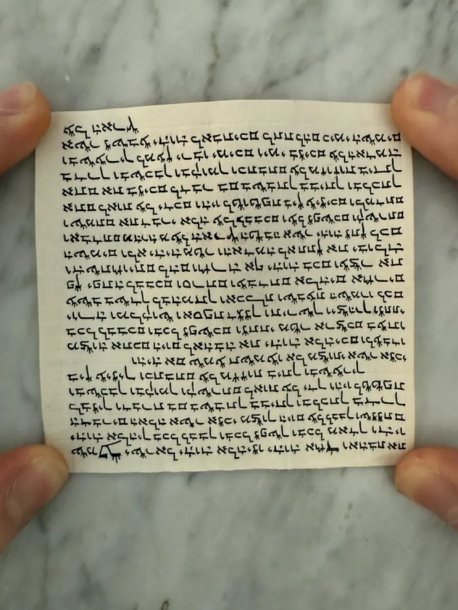

## Mon 2026-05-18 · Deciphering an unknown script (part 1 of 4)

**Woven from:** Claude “Deciphering an unknown script” (`claude/2026-01-03-deciphering-unknown-script.md`) + ChatGPT “Redwall Script Translation” (`chatgpt/10-redwall-script-translation.md`)

Claude capture notes — 2026-01-03-deciphering-unknown-script.md

- URL: https://claude.ai/chat/a47162d6-ba7f-426d-a131-7e3b5e0fcfd4
- Date shown: none shown in chat; Date (list): Jan 3, 2026
- Messages: 24 (12 Sam, 12 Claude)
- Attachments: 1 image(s) saved: 2026-01-03-1.png
- ⚑ day unsure for turns 1–11 of 12: Claude shows only the last-message date (Sat 2026-01-03); earlier turns may be earlier days

ChatGPT capture notes — 10-redwall-script-translation.md

- URL: https://chatgpt.com/g/g-p-69eaa35a58988191b08e2c01eb5abeeb/c/6a0b5cf3-a2e4-83e8-a9b3-286fd058cdce
- Date shown: Mon, May 18 at 11:39 AM (first stamp seen; others not captured); Date (list): none shown on project list
- Messages: 22 (11 Sam, 11 ChatGPT)
- Attachment thumbnails: 1 (first message image saved in images/)
- Woven with claude/2026-01-03-deciphering-unknown-script.md (8 of 11 turns matched by Sam's words; score 7.54)
- ⚑ day unsure for turns 2–11 of 11: only the start date (Mon 2026-05-18) is known

#### ◆ **ChatGPT** · *Redwall Script Translation* · `chatgpt/10-redwall-script-translation.md` · turn 1/11 · Mon 2026-05-18 · day: ChatGPT chat created (time in chat ID)

**Sam:**

I'm curious about what this says:

---

**ChatGPT:**

That’s a wonderfully nerdy cipher object: it appears to be the opening of The Hobbit written in the Royal House of Riftgard script from Brian Jacques’s Redwall universe.

The script is not a separate spoken language; it is basically an alternate writing system/alphabet used in Triss for Riftgard maps, clues, and inscriptions. 

It begins:

The Hobbit
In a hole in the ground there lived a hobbit.

Then it continues with the famous description that this was not a nasty, dirty, wet hole, but a comfortable hobbit-hole, including the round green door, brass knob, tunnel-like hall, panelled walls, tiled and carpeted floors, polished chairs, and pegs for hats and coats.

So: Tolkien text wearing Redwall clothes. Very good little vessel.

*Continues in [Saturday](../016-2026-01-03-sat-deciphering-an-unknown-script-part2/session.md).*
