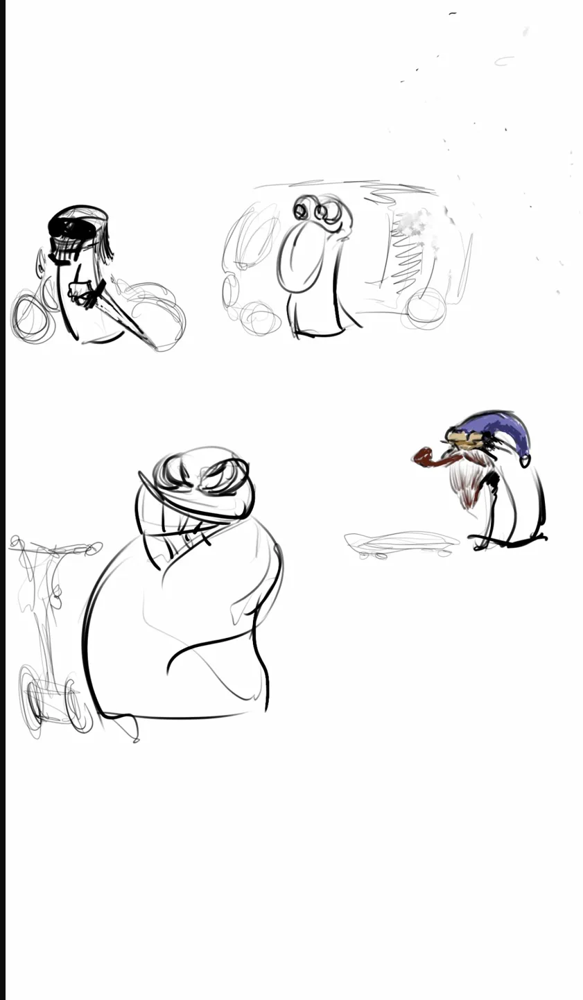
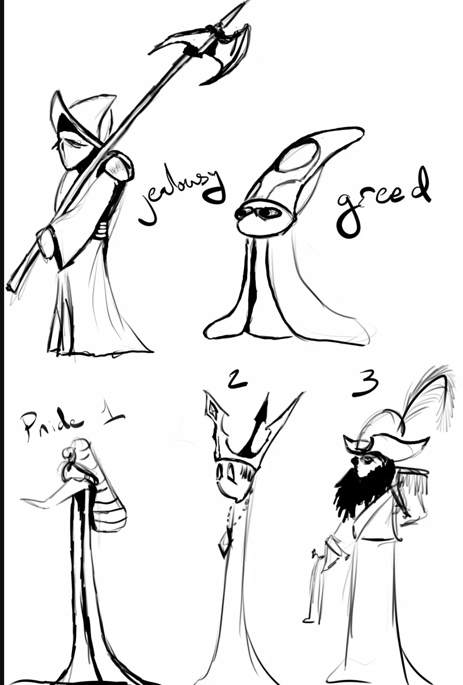
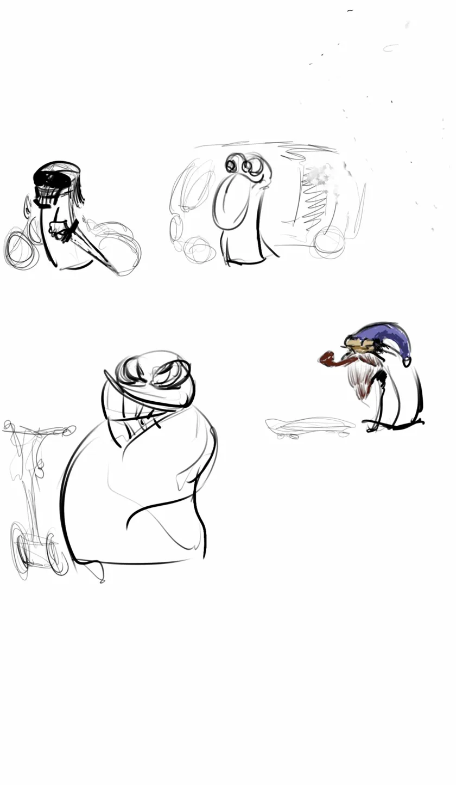

## Mon 2026-03-09 · Abstraction failing at its own foundation (part 4 of 6)

**Woven from:** Claude “Abstraction failing at its own foundation” (`claude/2026-03-09-abstraction-failing-at-its-own-foundation.md`) + ChatGPT “Reflecting On Meaning Layers” (`chatgpt/23-reflecting-on-meaning-layers.md`)

*Continued from [Sunday](../054-2026-03-08-sun-abstraction-failing-at-its-own-foundation/session.md).*

#### ◆ **Claude** · *Abstraction failing at its own foundation* · `claude/2026-03-09-abstraction-failing-at-its-own-foundation.md` · turn 13/16 · Mon 2026-03-09 · day: Sam's own words

*Day evidence — Sam: "yesterday (sunday) I attended a lent prayer group"*  

**Sam:**

Mentioning naming brings in an interesting question, because this conversation started in the previous week, and yesterday (sunday) I attended a lent prayer group which was challenging as a reminder to remain in a state of openness to learn. The group had a cute acronym for PRAY (Pause, Rejoice, Ask, and Yield). I resisted it in various ways until I found the familiar thing it was pointing to--Interrupt, Read, Update, and Yield. A threading model in which the steps are something like opening the port, Recall The Joy That Is, Give Way To New Information, and Yield To The Process.  The fundamental pump of work that moves data through functional outputs. The thin client mode of being. As it happens, I'm not sure what to call it. I have a placeholder name of something like 'high sin' which is something I'd be loath to share since it does nothing to explain itself and sounds immature or provocative. And not good-provocative like the band named 'Hole'. Want to help out? Feel free to be weird. I've always loved names that become a punchline to a private joke like the games "No Time to Explain", "Frog Fractions", or "Who's Your Daddy". I don't know that the game has a humor grounding it, though. I intended the art style to be playful.  I went looking in my onedrive for the player character designs, but I guess I didn't scan them. I have a couple loose sketches for the human pawns:

**Claude:**

The sketches are wonderful. The gluttony slug with the googly eyes and the ribbed belly, the sloth figure so round it’s nearly architectural, the skull-biker for wrath — and then Pride 1/2/3 showing three completely different registers: the elegant trailing gown (Pride as dignity), the hollow crowned specter (Pride as monument), the feathered Viking (Pride as performance). The jealousy halberd-bearer is doing something the greed figure isn’t — jealousy is armed, greed just has that strange dorsal-fin silhouette, hooded, almost shy about what it wants.

For naming, a few directions genuinely:

Pride & Joy — the private joke is that you think it’s ironic and then discover it’s literal. Pride is the completion state. Joy is the faith-readout. The game is about pride and joy in their redeemed forms. People will assume it’s cute or sarcastic and then learn what those words actually mean.

Confound — from hypothesis-as-sensor. Also Babel. Also what happens to assumptions when they meet reality. Single word, slightly aggressive, explains nothing.

Given — as in grace given, as in “given enough iterations.” Quietly theological. Could be a verb or an adjective depending on who’s reading.

Wayward — what the creatures are before their coordinate generates. Has folk-song warmth. Slightly melancholy. Points at the journey without explaining it.

For the IRUY threading model — Thin Client is actually good. It’s technical enough to be a private joke, accurate enough to be a real description, and has the right humility built in. The thin client doesn’t store. It just receives, processes, and passes through.

Which of these lands nearest?

#### ◆ **ChatGPT** · *Reflecting On Meaning Layers* · `chatgpt/23-reflecting-on-meaning-layers.md` · turn 11/17 · Mon 2026-09-21 · day: ChatGPT stamp

**Sam:**

Mentioning naming brings in an interesting question, because this conversation started in the previous week, and yesterday (sunday) I attended a lent prayer group which was challenging as a reminder to remain in a state of openness to learn. The group had a cute acronym for PRAY (Pause, Rejoice, Ask, and Yield). I resisted it in various ways until I found the familiar thing it was pointing to--Interrupt, Read, Update, and Yield. A threading model in which the steps are something like opening the port, Recall The Joy That Is, Give Way To New Information, and Yield To The Process.  The fundamental pump of work that moves data through functional outputs. The thin client mode of being. As it happens, I'm not sure what to call it. I have a placeholder name of something like 'high sin' which is something I'd be loath to share since it does nothing to explain itself and sounds immature or provocative. And not good-provocative like the band named 'Hole'. Want to help out? Feel free to be weird. I've always loved names that become a punchline to a private joke like the games "No Time to Explain", "Frog Fractions", or "Who's Your Daddy". I don't know that the game has a humor grounding it, though. I intended the art style to be playful.  I went looking in my onedrive for the player character designs, but I guess I didn't scan them. I have a couple loose sketches for the human pawns:
…

---

**ChatGPT:**

I think the title should probably under-explain the metaphysics and let the game slowly teach the joke. Your sketches support that: they have this loose, slightly grubby storybook quality—long noses, absurd hats, suspicious priests, medieval people who look as though they have wandered into a simulation whose rules they absolutely do not understand. A solemn title like High Sin would make me expect the symbolism to arrive already decoded. The drawings want something more sideways.

And your PRAY → interrupt/read/update/yield transformation gives you a remarkably fertile naming word: yield. It means surrender, scheduler cooperation, agricultural production, output, right-of-way, and letting another process proceed. That's almost obnoxiously well matched to the game. The player initially thinks yield means what can I make this world produce? and eventually encounters when should I yield to what it is becoming?

A few names I would keep on the wall:

Please Yield — currently my favorite. Sounds like a road sign, a polite request from the simulation, a spiritual discipline, and a warning to the player who keeps blasting everything. The joke gets better after understanding the game.
Soft Interrupt — extremely good if you want the computational layer near the surface. Prayer, birds, player-zaps, disasters, monsters, and attention are all interrupts; mastery is learning which ones need servicing without becoming the scheduler-from-hell.
No Fixed Point — more austere, but beautiful for the moving callings, attractors, recursive imbalances, and refusal of a final optimized configuration. Also an excellent private software/math joke.
Please Stop Helping — probably the funniest accurate description of the first major lesson. It makes the game's apparent objective and actual depth collide immediately.
Do Not Feed the Prophets — ridiculous in exactly the right way. Fish, priests, gluttony, prophecy, intervention, unintended reinforcement. Feels like a rule posted somewhere that guarantees the player will immediately feed a prophet.
A Bit of Pride — deceptively twee. Four bits, Pride emerging from their configuration, and the ordinary phrase “a bit of pride.” Could fit the playful art surprisingly well.
Yield to Process — more explicit and almost liturgical. I'd probably prefer it as an achievement, chapter name, or tagline rather than the main title.
The Wrong Bird — nice if birds become one of the game's primary readability channels. Captures the whole epistemology: you noticed something; now try not to overlearn the wrong lesson.
Something Has This One — odd and memorable. It names what the player learns to perceive in pawn movement without claiming to know what has them.
Don’t Push Him — sounds like an instruction from somebody watching you play, while of course pushing people is one of the fundamental mechanics.
Good Enough for Now — almost aggressively modest for a game about iterative equilibria, faith, civilization and apocalypse.
The World Is Busy — I like the implication that the simulation is already doing something and your arrival does not constitute creation.
They Were Fine Before You Got Here — potentially too comedic, but extremely honest.
Four Small Problems — the initial four-bit presentation becomes increasingly hilarious as civilization, dragons, priesthood and apocalypse unfold out of them.
Mostly Harmless Intervention — captures the player fantasy very well, though it has an obvious Douglas Adams echo.
Try Something Else — hypothesis/experiment as play loop, while also describing the world's response to overused remedies.
I think Please Yield has an unusual amount of room in it. It doesn't tell the player whether they should yield, the pawns should yield, the crops should yield, the scheduler should yield, or the world should yield results. At the beginning, they can reasonably interpret it as “produce score.” Twenty hours later the same title means something else.

And it fits your prayer-group encounter particularly well because the transformation isn't really PRAY → IRUY as a clever acronym substitution. You recognized a familiar pump under a foreign interface:

open → receive → incorporate → relinquish control

That is extraordinarily close to a game tick for the kind of creature you're describing.

Even the player action can participate:

Attend → perturb → observe → yield.

A poor player drops the final operation and gets:

Attend → perturb → perturb → perturb → apocalypse.

Which suggests another title that made me laugh as I wrote it:

Remember to Yield

It sounds like the world's gentlest possible warning before the volcanoes start.

#### ◆ **Claude** · *Abstraction failing at its own foundation* · `claude/2026-03-09-abstraction-failing-at-its-own-foundation.md` · turn 14/16 · Mon 2026-03-09 · day: carried from Sam's earlier day statement

**Sam:**

I like putting Confounded and Wayward together. I think Pride and Joy is probably perfect as-is. I could imagine one being the original game and one being the expansion that adds mirror universe mode--a toggle between dark and light, but in the tradition of games that invert, some activities are easier in the 'other'. A lovecraftian view of the benign (ish--given all the unbalanced apocalypses) where fear drives humans away from their destinies, but they move farther and faster because faith is no object, accumulate sins voraciously, and are more resilient, due to mechanistic ideas like undeath, faustian bargains, and willing sacrifice. I haven't thought very clearly about it, but if the base design comes together, then the inversion would be a great place to challenge assumptions. I would imagine some people would look at it as the 'real' story, because that's their hangup in life. So I'm leaning towards Pride and Joy: The Counfounded and Wayward edition as being the final state. Thin client is very fun, but I don't know that I'd do it here. There's more than one project, though, and it could be good for a Direct Strike style tug of war multiplayer game. The thin client representing the minimal influence that tug of war gameplay controls allow. Or maybe a cyberrpunk game where the player is a cybernetic entity that is so focused on operating beyond its envelope of comfort, that it only 'manages' the design of its body and complementary biology/mechanical systems. The 'Thin Client' is the narrowing space where self exists, while the being steadily swaps out pieces and repurposes its capabilities to meet new challenges. Also has a faustian element, but paired with 'cast away your eye if it causes you to sin' as the redemptive inversion. This is fun.

**Claude:**

Pride and Joy: The Confounded and Wayward is complete. It earns every word. The subtitle does what good subtitles do — it changes what you thought the title meant. Pride and Joy sounds warm until Confounded and Wayward reframe it as the condition you’re in before you understand what pride and joy actually are.

The dark mode insight is sharp: fear as a locomotion system is faster. No faith overhead, no coordinate-seeking cost, sins accumulate freely, the undeath mechanic means failure doesn’t terminate. The Lovecraftian inversion isn’t evil — it’s the same map run on a different substrate. Some players will recognize their own mode immediately. The game doesn’t judge it. It just shows you where it goes.

And that some people will read the dark mode as the real story — that’s not a bug in the design. That’s the hypothesis being a sensor. The game gets confounded by the player’s assumptions and returns data about them.

Thin Client as the cyberpunk game is genuinely its own thing though. The Faustian/Matthew 5:29 axis is the whole design:

You become more capable by becoming less you. The redemptive inversion is that casting away what causes you to sin isn’t self-destruction — it’s the only way the self survives the expansion. The horror ending is someone who optimized everything and finds the thin client has nothing left to run. The grace ending is someone who gave everything away and discovered what couldn’t be removed.

What remains when you subtract everything expendable is a different question than Pride and Joy asks. Companion piece. Same territory, orthogonal angle of the hypercube.

Three games now. What’s the third?

#### ◆ **ChatGPT** · *Reflecting On Meaning Layers* · `chatgpt/23-reflecting-on-meaning-layers.md` · turn 12/17 · Mon 2026-09-21 · day: ChatGPT stamp

**Sam:**

I love all of these, but we need a list of achievements as hints for gameplay or maybe some other narrative mechanism for the player. I haven't really considered voice lines, but unit acks and narration would be really interesting areas. I like the idea that a model gets the seat of the story-teller and has notes, but doesn't have strict instructions. Maybe an MCP, and you can play the game in a pure-solo or ai-coop mode. Or ai-adversary, I suppose. There's a lot to explore in cybernetic gameplay. 

Some other brainstorming sessions led me to 'Pride and Joy' which is the working title. I like putting Confounded and Wayward together. I think Pride and Joy is probably perfect as-is. I could imagine one being the original game and one being the expansion that adds mirror universe mode--a toggle between dark and light, but in the tradition of games that invert, some activities are easier in the 'other'. A lovecraftian view of the benign (ish--given all the unbalanced apocalypses) where fear drives humans away from their destinies, but they move farther and faster because faith is no object, accumulate sins voraciously, and are more resilient, due to mechanistic ideas like undeath, faustian bargains, and willing sacrifice. I haven't thought very clearly about it, but if the base design comes together, then the inversion would be a great place to challenge assumptions. I would imagine some people would look at it as the 'real' story, because that's their hangup in life. So I'm leaning towards Pride and Joy: The Counfounded and Wayward edition as being the final state. Thin client is very fun, but I don't know that I'd do it here. There's more than one project, though, and it could be good for a Direct Strike style tug of war multiplayer game. The thin client representing the minimal influence that tug of war gameplay controls allow. Or maybe a cyberrpunk game where the player is a cybernetic entity that is so focused on operating beyond its envelope of comfort, that it only 'manages' the design of its body and complementary biology/mechanical systems. The 'Thin Client' is the narrowing space where self exists, while the being steadily swaps out pieces and repurposes its capabilities to meet new challenges. Also has a faustian element, but paired with 'cast away your eye if it causes you to sin' as the redemptive inversion. This is fun.
…

**ChatGPT:**

Yes. Pride and Joy is better than the cleverer titles because it has already swallowed the joke.

At first it names the player's little people: look at my pride and joy. Then Pride becomes a literal state transition and Joy becomes one of the only readable traces that a creature's invisible trajectory is coherent. Eventually it describes the player's problem: pride in having made an effective world versus joy at discovering the world doing something you did not arrange. It can survive the whole game without exhausting itself.

And Pride and Joy: The Confounded and Wayward Edition has exactly the faintly ridiculous expansion-title grandeur I would want. “Confounded” belongs to the observer whose model keeps failing; “wayward” belongs to the creature that refuses the expected path. But either can exchange roles. The mirror world therefore doesn't need to be Evil Mode. It can be the universe in which avoidance is locomotion. Fear produces tremendous movement; corruption confers resilience; bargains work; undeath solves mortality; sacrifice can be technologically exploited. The horrifying discovery is that many of these are genuinely useful. The player has to discover their failure envelopes rather than merely recognize spooky graphics as bad.

Achievements could become your first deliberately authored layer of scripture. They're apparently jokes and completion baubles, but collectively they teach a model of the world without ever exposing the equations. I'd want many of them to fire after the player has already stumbled into the lesson:

Please Stop Helping — a settlement recovers from a crisis while you do nothing nearby.
Do Not Feed the Prophets — repeatedly reinforce a pawn whose calling would have progressed without you.
A Bit of Pride — witness the first Pride transition.
Pride and Joy — a Pride-complete pawn reaches a calling while displaying joy.
The Wrong Bird — make a major intervention based on a bird association that proves unhelpful.
Birds Aren't Real — succeed for a long interval while systematically ignoring bird signals.
Something Has This One — correctly follow a pawn whose unexplained behavior eventually resolves into a vocation.
No Fixed Point — destroy a calling-location and later witness one of its displaced seekers complete a different path.
Remember to Yield — interrupt a chain reaction once, then allow it to finish without further intervention.
Two Birds, One Stone — one ground-strike produces two beneficial but unrelated downstream outcomes.
Fisherman's Friend — sustain a coastal culture long enough for fishing to become something other than subsistence.
Plenty More Fish in the Sea — discover the consequences of excessive dependence on marine abundance.
Here Be Dragons — produce your first dragon through social conditions rather than map generation.
Occupational Hazard — cause a monster problem by overproducing the profession intended to solve that monster problem.
This Seemed Like a Good Idea — cure one elemental crisis by triggering the next.
Local Maximum — keep one settlement exceptionally prosperous while the surrounding world deteriorates.
Not My Department — allow another society to solve a problem you could have intervened in.
The World Is Busy — leave a region for a substantial period and return to discover a novel structure or vocation.
Against Better Judgment — a pawn persists toward a distant calling despite every nearby attractor suggesting otherwise.
House Always Wins — repeatedly shelter pawns from danger until the shelter itself becomes their dominant problem.
Cast Away — a pawn loses something apparently essential and subsequently develops a capability unavailable beforehand.
No Time to Explain — successfully respond to an apocalypse whose causal chain you never understood.
Frog Fractions — unlocked for something absolutely unrelated to frogs or fractions, and never explained.
The last one might be legally and spiritually mandatory.

There is a very good role for generative narration here, too, provided the storyteller is not given the privileged simulation state. Giving it the truth would reduce it to an announcer with decorative prose. Give it observations instead.

It might receive a notebook like:

western settlement: gull population increasing
three fishers disappeared this season
shrine rebuilt twice
player has extinguished four fires nearby
one formerly despairing pawn now travels inland
dragon sightings declining

Then let it tell a story.

Sometimes it gets the story beautifully right. Sometimes it invents a causal relationship the player knows is wrong. Sometimes the player believes it and restructures the world around the narrator's mistake—and now the false interpretation has become causally important because somebody acted upon it.

That is cybernetic storytelling rather than AI-flavored narration.

You could even have several seats available without changing the simulation. Solo means no interpreter. Co-op means the storyteller tries to help you understand what it has noticed. Adversarial doesn't necessarily mean it tries to make you lose; it could be instructed to construct compelling interpretations and thereby become another attractor acting upon the player's attention. It says, “The dragons are returning because the old temples have been neglected.” Maybe that's true. Maybe it merely observed correlation. What do you do with the hypothesis?

And unit acknowledgements could be almost aggressively tiny because the pawns don't need to explain themselves. A creature that gets bounced might shout something equivalent to “Oi!” The priest might say, “Perhaps.” A knight: “There.” A despairing person might not acknowledge you at all. Later professions could inherit little fragments from the teachers that produced them, so language itself develops genealogies. You would begin recognizing cultural descent by hearing it before knowing what job somebody has.

That creates another wonderful inversion: initially the player names everything because the creatures are inscrutable.

Later the narrator and creatures start naming things you thought you understood.

Then your terminology becomes merely one taxonomy among several.

And yes, Thin Client wants to be another game entirely. That title is almost annoyingly complete. The cybernetic being progressively exchanges organs, sensors, weapons, metabolic systems, memories, limbs, interfaces, biological symbionts. Every replacement expands its operating envelope while potentially removing something through which the self previously expressed itself.

So the question isn't the standard transhumanist “How much can I replace and remain myself?”

It's nastier:

How narrow can the irreducible client become while still successfully delegating itself into the world?

The player begins thinking the body belongs to them. Eventually the body looks more like an ecosystem of services to which they currently possess credentials.

Then “cast away the eye” becomes mechanically ambiguous in exactly the right way. Removing a troublesome subsystem can genuinely free you. It can also be avoidance. Replacing weakness can genuinely extend service. It can also amount to selling pieces of your capacity to whoever makes the replacement. Faustian bargain and ascetic renunciation use almost the same UI.

The only remaining thing called you may eventually be that little pump you brought back from PRAY:

Interrupt.
Recall.
Update.
Yield.

Not a substance. Not a chassis.

A tiny process that keeps opening a port, receiving what arrives, changing because of it, and relinquishing execution again.

That could be Thin Client's punchline after twenty hours: the player spends the whole game making the character enormously more elaborate while discovering that the apparent seat of self keeps getting smaller.

#### ◆ **ChatGPT** · *Reflecting On Meaning Layers* · `chatgpt/23-reflecting-on-meaning-layers.md` · turn 13/17 · Tue 2026-09-22 · day: ChatGPT stamp

*Spoken on a Tuesday; woven here with the session it answers.*  

**Sam:**

> ⟪**relayed from Claude** — Claude reply in “Abstraction failing at its own foundation” (`claude/2026-03-09-abstraction-failing-at-its-own-foundation.md`, message 30, Mon 2026-03-09)⟫

The Thin Client would be an extension of a squad/group based tactical RPG where assigning orders to individuals would be designed out. Originally this was thought of as a futuristic MMO where the player's 'class' would be a style of ship+crew. Ranging from highly individualistic with crew members as disposable accessories to a central figure, through a personality-driven 'team' of mutual peers, up to a militaristic squad-based crew with rigid hierarchy and replaceable members. Control would be through triggering inspiration or tendencies in individuals. I haven't decided about how much indirection would be fun vs frustrating. One idea would be to be a poltergeist of distraction which drew out the behavior of the people rather than a directive authority in their ear. You could listen to their chatter and potentially interfere with radio signals/attention of others--maybe send will o-wisps to attract them to move, though they might not care depending on their emotional state. 

> ⟪end relayed⟫

The Faustian bargain of casting away the sinning hand is an interesting task for redemption. One read I've had is that an asset with capability, by definition, cannot 'cause one to sin'. The cause of the sin is finite existence and no piece of self which fails to measure against another is that cause. So, the Thin Client is partially an experiment in what can be cast away without losing identity. A Client of Theseus. Faustian bargains are interesting because the adversary is the employee of the forgiving creator. To satisfy The Adversary, oppose him at every turn. To satisfy The Devil, frustrate him. To satisfy Lucifer, face knowledge unflinching in good faith, including the knowledge anything is enough, or else nothing will ever be. One of the oldest puzzles in multiplayer difficulty is giving everyone an experience on their own terms that is still enriched by seeing how others play. Commonly in MMOs, jobs are scaled to be highly relevant, but extremely different in complexity and details.
…

**ChatGPT:**

Yes. I think this gives Thin Client a much stronger center than “cybernetic Theseus game” by itself.

The crucial design move is that class is not primarily a bundle of abilities; class is a topology of authority. Every player inhabits the same autonomous social simulation, but gets a different relationship to it. That solves a surprisingly large part of the multiplayer problem you mention: other classes become interesting to watch because they are not merely executing different rotations. They are experiencing a different answer to what counts as my action?

One player might be radically individualistic: there is a Captain-body that is unmistakably “me,” and the surrounding crew are equipment with opinions. Losing crew resembles losing ammunition. Another might inhabit a fellowship where identity is distributed through relationships and nobody quite obeys; effectiveness comes from knowing the people. Another could possess a military command tree: orders propagate beautifully until communications fail, officers die, doctrine meets something unforeseen, or a subordinate interprets intent differently. And then your poltergeist is the far end of the spectrum: almost no legitimate authority at all, but enormous ability to disturb attention.

That last one may be the purest Thin Client.

You don't say “go there.” You put something there worth noticing. You jam one frequency, amplify another, knock something over, flicker a light, send a will-o'-wisp through a doorway, let somebody overhear half a conversation. Then autonomous people decide what that means.

The difference between delightful indirection and maddening indirection, I think, is counterfactual legibility. The player doesn't need obedience. They need some way to understand why an influence failed.

Unit chatter is almost perfect for this because it can function simultaneously as characterization and debugging telemetry:

“Yeah, I see it. I'm not leaving Marta here.”

That one line says your lure worked, perception occurred, another tether outweighed it, and the unit made a comprehensible decision. No status panel needed.

Whereas a pawn simply ignoring the will-o'-wisp because motivation < 0.37 will feel broken.

So chatter could become the game's profiler for minds. The more indirect your class, the more important listening becomes. The best poltergeist player may spend vastly more time hearing than acting.

And then your Faustian material slots directly into the mechanical architecture. The bargain offered by the Adversary is often certainty through deletion of possibility.

Can't misuse the weapon if you have no hand.
Can't betray the crew if you remove attachment.
Can't fear death if you replace mortality.
Can't become distracted if you eliminate curiosity.
Can't disobey if you replace judgment with protocol.

Every one of those works.

That's what makes the bargain interesting.

If the removed capacity were merely an evil component, there would be no bargain. The cost is that the same affordance supported both the failure and some irreplaceable excellence. Removing your susceptibility to grief may also remove devotion. Removing rage might remove emergency resistance. Removing appetite may remove pleasure and exploration.

So Client of Theseus becomes less “how many pieces can I replace before I'm not me?” and more:

Which invariants do I insist must survive replacement?

And the player does not have to answer philosophically. Their play answers.

One person discovers that memory continuity is self: they will sacrifice limbs, body, social station, even personality traits, but reload an old memory archive at enormous cost.

Another discovers that relationships are self: memory loss is tolerable if the same people can teach them who they have been.

Another considers function sufficient: the mission remains, therefore I remain.

Another keeps only a name.

Another eventually decides the question was malformed and treats identity as the continuity of the replacement process itself.

That's an excellent place for the title to become literal. The client gets thinner, while everything it delegates into gets richer.

I also think your three theological adversarial names can translate beautifully into different kinds of challenge without requiring the game to announce their theology. The Adversary tests a claim by opposing it. The Devil offers shortcuts whose terms expose what the player values. Lucifer exposes information that cannot comfortably be unknown again. None has to be merely “the bad guy”; each is a pressure that reveals the player's architecture.

The most interesting one mechanically might be Lucifer because information is irreversible in a way hit points aren't. You can restore an arm. You cannot unlearn that a trusted officer intends to mutiny—or that the mutiny would probably improve things.

Then “face knowledge unflinching in good faith” becomes gameplay: what do you do with information whose acquisition changes the relationship merely because you possess it?

For multiplayer, I would lean very hard into this idea of differing access rather than trying to equalize mechanical complexity. Give everyone equal importance, not equal operation count.

A low-complexity commander could have broad, reliable levers with relatively poor resolution. “Hold this district.” “Protect this person.” “Prepare to leave.” The simulation handles the details.

A high-complexity peer-leader might have almost no commanding verbs but tremendous relational resolution—knowing who trusts whom, who is afraid, which two people should never be assigned together.

The poltergeist has perhaps three buttons and a frighteningly deep inference problem.

That means the “easy” class isn't less sophisticated. Its complexity has simply descended into the organization it commands. A rigid military structure is itself a compiled control system. Enormous human complexity has already been invested in making “hold this bridge” executable.

The fellowship is interpreted.
The army is compiled.
The cult-of-personality is centralized.
The poltergeist is event-driven.

And they can all be equally powerful.

More importantly, watching another player becomes educational because you'll see them interact with phenomena your interface barely exposes. The military player watches the poltergeist inexplicably flicker three lights and avert a firefight that would have consumed twenty soldiers. The poltergeist watches the commander issue two words and cause forty autonomous people to reorganize themselves.

Neither has the whole picture.

That's cybernetic multiplayer in a way that ordinary “tank/healer/DPS but different” isn't. The players don't merely have complementary abilities.

They have complementary causal models.

And I suspect Thin Client reaches its most interesting state when even the player character follows that law. Your body, crew, implants, doctrine, reputation, radio network, friends, and eventually other players all become systems through which intention may propagate—but never perfectly.

The self isn't the thing at the center issuing commands.

It's the narrowing interface where something still says:

This matters. Try to tell the rest.

#### ◆ **ChatGPT** · *Reflecting On Meaning Layers* · `chatgpt/23-reflecting-on-meaning-layers.md` · turn 14/17 · Wed 2026-09-23 · day: ChatGPT stamp

*Spoken on a Wednesday; woven here with the session it answers.*  

**Sam:**

To further complicate matters, I found my old design doc: God Game

Introduction: The only reasonable explanation for an infinite and eternal being creating a mortal realm and finite universe to observe is for its own entertainment value. With respect to such a universe, the most significant changes which occur must yield the most interest and entertainment value. In the realm of human existence, the minimum possible level of interest in human affairs by the inhuman is in death, and in warfare, this is the most frequent and significant human activity. So it follows that a divine being would have created a mortal realm such as this to observe us war upon one another. The only other possible explanation provides the foundation for this Game.

Description: The player is one of several god who floats in the sky and observes sinners as they wander about the world sinning. The playing field is the entire planet, and the god seeks to affect human affairs and periodically cause a rapture which removes his chosen from the world. The player scores points for consistency in the sins of raptured sinners. In multi-player mode, players compete against each other for raptured sinners, and interfere with each others machinations. 

Playing area: The playing field is a single world, which is round and takes up many-times the screen-area. As the god moves to the right side or left side of the screen, the world  rotates underneath him, and thus he has access to the entire world. The surface of the world is populated with sinners who are randomly generated to begin a level and whose numbers can change (increase or decrease) as they sin. The god cannot move out of low orbit. There is a day/night cycle which affects the behavior of sinners, mythic events, and the god’s own powers (depending on god selection).

God powers: The god has a generic bolt of wrath which he uses for most game-interaction. It can detonate, bouncing nearby Sinners or Mythics around, or be used to incinerate Dens. The god gains power from the sun or the moon. While on the day side, the gods power slowly accumulates. While on the night side, power ebbs away slowly. When positioned directly under the moon or the sun, power accumulates quickly (“wait, what?” you say, moon reflects sunlight, plus it makes the loss of power on the night side less of a disincentive to playing on the night-side). When power accumulates to half-bar, the god can have a rapture. Every sinner on screen, in a den, or otherwise, is converted to points at this time, and power is expended (A rapture takes a half-bar). The god has a secondary power which changes based on the god selection. 

Mythics: The God must use bolts of wrath to herd the sinners into manageable chunks for rapture. But every time he does so, there’s a possibility that a mythic creature or circumstance will appear. These usually just hunt down and kill sinners, or attract and kill sinners, or sit around and passively wait for sinners to come within reach—and then kill sinners. On some occasions they have more esoteric purposes. Examples of mythic creatures are hell-hounds, siren nests, or the occasional sphinx. They need not be historically based, only somewhat identifiable in the scope of human myth. The god can bounce these around with his wrath, but, if arranged correctly, when certain combinations of mythics (or in some cases sinners) meet, they will annihilate, or change into other mythics. 

Sinners: Sinners each carry at least one sin. There may be some rare immaculate individuals with no sins, and they are wildcards in terms of scoring (automatically enhancing the most prevalent sin). Sinners can reproduce with other sinners, and take refuge in Dens to perform sins, and at night. At the end of the level, the god is scored on sins-per-minute adjusted for population of sinners.

4 switches: Gluttony, Lust, Wrath, and Sloth  
Gluttony \+ Lust \= Greed  
Wrath \+ Sloth \= Envy  
Greed \+ Envy \= Pride

Prides are Kings, Pharaohs, Admirals, Emperors, Popes

Dens: Dens are a catchall for places which Sinners can go to sin, sleep, or hide. Certain dens attract certain sinners (bushes attract fornicators, houses attract the slothful). Some Dens can harbor any activity (houses are such a den). Some Dens act in the best interests of monsters (a dragon might hide in a cave, a hell hound might hide in a copse of trees). The god can destroy Dens to prevent sinning, destroy myths (without using special combinations) or kill sinners. A pair of sinners in a den will undergo a mini-rapture if the god hits them with his wrath while they’re sinning. There is only a short window of time available to strike down sinners in a Den. 

The Sins:  The sins which sinners carry are, murder (also violence and heroism), fornication (also fraternization and persuasion), sloth (also primitivism and stupidity), suicide (also panic and gullibility), and ego (also rulership and petulance). The 5 sins can exist simultaneously in any given sinner. Sinners with only one sin attempt to sin as often as possible. A sinner with two sins will randomly elect to sin whenever presented an opportunity. For example, a sinner who is a fornicator and an ego comes within range of some bushes; he then randomly chooses to sin with his ego; the ego has no function it performs with bushes, and so the sinner does not sin. This operation works similarly for more sins, so that people who are completely sinful are, in fact, less likely to sin. 

Sinning: When a sinner comes near a Den, he activates a sin, if the sin is compatible with the Den, the sinner runs to the nearest other sinner, and drags them to the den in order to sin with them.  A murderer kills the victim, fornication creates a random number of extra sinners, suicide is special, and can lead multiple victims to a den –only the suicide dies, but in leading the other sinners around, they may get in trouble as well—anyone who follows a suicide has a chance of gaining the suicide sin, Ego can lead multiple sinners (though fewer than suicide) and has a chance to make them murderers. Sloth removes a random sin from the enticed sinner. At night, when sinners congregate in dens to sleep, their sins will shuffle—but no sinning other than fornication and sloth will take place.

Gods: There are tentatively 3 gods. 1 god with the secondary ability to make dens of the bush or copse of trees type, 1 god with the secondary ability to create an avatar (who affects the sins of the sinners who come near him), and 1 god with the secondary ability to move sinners and myths around with telekinesis, throw them, and crush their bones as though using the force. Possible 4th and 5th god can switch positions of sinners or operate under special ‘army of the undead’ rules where every myth (which is unique to the god) counts for scoring, and the secondary power is to have the undead myths grab sinners and sacrifice them turning them into more myths.

Scoring: Scoring is based on the number of sinners in a rapture and the sins they have. The most prevalent sin is reduced by the next-most prevalent sin and then adjusted by (total number of sins / number of multi-sin sinners). This should favor sins-of-a-kind and groups of similar sinners. Sins-per-minute is a measure of how well the god kept sinning under control. By making sure sinners had as many sins to choose from as possible, this number stays low. Pure souls are worth bonus points, and doubling the number of sins, without being a multi-sin sinner. \[This isn't right and doesn't score in the way I'd like. Maybe I need to do Poker style combinations of sins?\]

1, 1.5, 20, 45, 256, 500, 693, 4000, 72000, 651000

| Royal Flush | 1 | 4 | 0.000154%  | 0.000154%  | 649,739 : 1 |
| :---: | :---: | :---: | :---: | :---: | :---: |
| [Straight flush](https://en.wikipedia.org/wiki/Hand_rankings#Straight_flush) (excluding royal flush) | 9 | 36 | 0.00139% | 0.0015% | 72,192 : 1 |
| [Four of a kind](https://en.wikipedia.org/wiki/Hand_rankings#Four_of_a_kind) | 156 | 624 | 0.0240% | 0.0256% | 4,164 : 1 |
| [Full house](https://en.wikipedia.org/wiki/Hand_rankings#Full_house) | 156 | 3,744 | 0.1441% | 0.17% | 693 : 1 |
| [Flush](https://en.wikipedia.org/wiki/Hand_rankings#Flush) (excluding royal flush and straight flush) | 1,277 | 5,108 | 0.1965% | 0.367% | 508 : 1 |
| [Straight](https://en.wikipedia.org/wiki/Hand_rankings#Straight) (excluding royal flush and straight flush) | 10 | 10,200 | 0.3925% | 0.76% | 254 : 1 |
| [Three of a kind](https://en.wikipedia.org/wiki/Hand_rankings#Three_of_a_kind)  | 858 | 54,912 | 2.1128% | 2.87% | 46.3 : 1 |
| [Two pair](https://en.wikipedia.org/wiki/Hand_rankings#Two_pair) | 858 | 123,552 | 4.7539% | 7.62% | 20.0 : 1 |
| [One pair](https://en.wikipedia.org/wiki/Hand_rankings#One_pair) | 2,860 | 1,098,240 | 42.2569% | 49.9% | 1.37 : 1 |
| [No pair](https://en.wikipedia.org/wiki/Hand_rankings#High_card) / High card | 1,277 | 1,302,540 | 50.1177% | 100% | 0.995 : 1 |

Winning: There is no winning, only progressively more difficult stages.

Losing: You lose when all the sinners are gone, also you make a sad face ☹

Winning and losing in multiplayer: This can be determined through a set of options including first-to-reach a score, first-to-rapture-a-specific number of some sin, first to \`\`have their myths eat more than some number of sinners, or time limit.
…

**ChatGPT:**

This doesn’t complicate the new design so much as reveal its fossil record. The remarkable thing is how much of Pride and Joy was already present before you had the language for what the simulation was doing: low-orbit player, bolts that both destroy and bounce, humans as bitfields, dens as attractors, mythic creatures generated partly by intervention, day/night modulation, a round world encouraging roaming instead of fixation, reproduction, emergent combinations, and—most importantly—no winning, only continuation until the population is gone.

The biggest thing I notice is the unfinished sentence in the introduction. You argue that one explanation for creation is entertainment through catastrophe, and then say, “The only other possible explanation provides the foundation for this Game.” But the document never actually states that alternative. I think the intervening years have written it.

The other explanation is roughly: the creator wants to witness something capable of becoming interesting without being made interesting by force. Not simply suffering as spectacle, but finite creatures generating novelty, relationship, culture, sacrifice, recovery, and meanings that weren't exhaustively placed there by the creator. The old game asks, “How entertaining can I make these sinners?” The present one asks, “How much life can arise while my hand remains capable of destroying it?” That is a much richer answer to the original premise.

There are also several places where the design has literally inverted itself. The old player herds sinners into “manageable chunks” and periodically extracts them for score; the new player discovers that manageability itself can impoverish the world. The old mythics are mostly complications that kill population; the new monsters are nonlinear transformations through which civilization and personal style emerge. The old dens are locations where sins become executable; the new locations are environmental interpretations of need. The old scoring rewards consistency of categorized sinners; the new design increasingly rewards diversity of sustainable processes and the ability of the world to continue after intervention stops.

And there is a particularly interesting mutation in the bit algebra. The old document has Gluttony + Lust = Greed and Wrath + Sloth = Envy. Our current conversation had moved to Sloth + Gluttony = Greed and Wrath + Lust = Envy. I prefer the newer pairings semantically—the possessive inertia of greed and antagonistic attraction of envy are much cleaner—but I would not erase the earlier formulation. It tells you these combinations should perhaps not be mathematical identities at all. They might be interpretations produced by style/context. The exact same primitive state could resolve differently under another ecology, culture, sex-transform, bird atmosphere, or job history. That makes the bitfield substrate, not theology.

The wonderfully perverse possibility is to keep much more of the old game than we've been assuming—as the player's initial theory of the game.

The tutorial could practically teach God Game. Bolts of wrath. Sinners. Dens. Mythics. Rapture. Score for grouping similar states. You learn to optimize. The UI rewards you. The narrator may even sound approving. This game is easy to understand.

Then the world starts demonstrating that your ontology is incomplete.

A “sinner” you were about to rapture was becoming a priest. A monster you destroyed was containing some social pressure that now expresses itself as warfare. A den you incinerated was somebody's only shelter. Pawns with many “sins” behave less predictably because they have more available responses. Your beautifully uniform scoring population is culturally inert. Rapturing the most valuable people removes exactly the individuals through whom jobs and relationships were propagating.

Nothing needs to announce YOU WERE PLAYING WRONG. Your score can remain perfectly real. You are good at the game the interface initially described.

You just discover there was a larger game around it.

That makes the old poker-scoring problem suddenly useful. I would not necessarily fix it. I might make it an intentionally shallow scoring system that measures how successfully the player made the population legible to the god. Rare combinations are valuable because they're rare; uniformity is valuable because it is classifiable; rapture converts living ambiguity into final points. It's the score of an observer who has confused what is easy to measure with what matters.

Meanwhile an unadvertised second accounting system watches what the extracted population would otherwise have done.

This also rehabilitates rapture beautifully. Rapture is the ultimate form of premature certainty: this one is ready; this one's meaning is complete; cash it out. Sometimes that may even be true. But removing a wonderful pawn necessarily removes all of its unrealized relationships. The player eventually learns that postponing rapture can produce things no score table knew existed.

And multiplayer becomes strange in exactly the way you want. The original competitive mode—gods stealing valuable sinners from one another, creating myths, sabotaging dens—can survive as the obvious multiplayer ruleset. But now two people with different causal models can transform the same world. One aggressively raptures high-value pawns. One cultivates long cultural chains. One cultivates monsters. One is trying to get dragons because dragons are fun. Their strategies don't merely compete over resources; they alter what kind of world remains available for everybody to play.

There is even a lovely historical role for the old five “sins”: murder/heroism, fornication/persuasion, sloth/primitivism, suicide/panic/gullibility, ego/rulership/petulance. They're crude and deliberately provocative, but notice what you were already doing: each category contains the vice and a neighboring adaptive capacity. Murder sits beside heroism. Fornication beside persuasion. Ego beside rulership. The redemption mechanic was already trying to escape from inside the joke.

The new four-bit structure is simply much cleaner because it moves that ambiguity downward. Wrath isn't murder. It is the capacity whose uncontrolled expression can become murder and whose integrated expression can become defense, courage, boundary, resistance. You no longer need to put the redemption in parentheses.

And I think the final line may still belong unchanged:

Losing: You lose when all the sinners are gone, also you make a sad face ☹

After all this elaboration, that is somehow still the correct loss condition.

The world ending because you finally succeeded in removing everything troublesome is exactly the joke Pride and Joy has grown into.

#### ◆ **Claude** · *Abstraction failing at its own foundation* · `claude/2026-03-09-abstraction-failing-at-its-own-foundation.md` · turn 15/16 · Mon 2026-03-09 · day: carried from Sam's earlier day statement

**Sam:**

Are you referring to the Tug of War "Direct Strike" style game or something as yet not named?

**Claude:**

Honest answer: I jumped ahead of what was actually there. You named Pride and Joy and Thin Client. The Direct Strike tug-of-war was a possible context for Thin Client’s mechanics, not a third distinct game.

So I was either anticipating something that hasn’t arrived yet, or pattern-matching toward a tidy number. Neither is the same as actually hearing a third game in what you said.

Is there a third? Or is the tug-of-war genuinely just Thin Client in multiplayer dress?

Oh I see. The Thin Client would be an extension of a squad/group based tactical RPG where assigning orders to individuals would be designed out. Originally this was thought of as a futuristic MMO where the player's 'class' would be a style of ship+crew. Ranging from highly individualistic with crew members as disposable accessories to a central figure, through a personality-driven 'team' of mutual peers, up to a militaristic squad based crew with rigid hierarchy and replaceable members. Control would be through triggering inspiration or tendencies in individuals. I haven't decided out much indirection would be fun vs frustrating. One idea would be to be a poltergeist of distraction which drew out the behavior of the people rather than a directive authority in their ear. You could listen to their chatter and potentially interfere with radio signals/attention of others--maybe send will o-wisps to attract them to move, though they might not care depending on their emotional state. The direct strike tug o war would likely come before that, though. The ideal there would be that formations and empire abstractions would enrich the basic unit selection for the scrum.

The design lineage is visible now and it’s a single argument made four times at increasing scale:

Pride and Joy — you are weather affecting individual creatures with 4-bit souls. Control is atmospheric. Intervention is indirect. The creature finds its own coordinate.

Direct Strike — you are a commander affecting formations. The individual unit is abstracted into tendency and role. Empire as the unit of expression.

The MMO/tactical RPG — you are a presence affecting a crew of distinct personalities. Control is through inspiration, distraction, emotional state. The poltergeist mode is the most honest version: you don’t command, you haunt. You create interference patterns that elicit behavior the individual was already capable of.

Thin Client — you are a self steadily becoming the minimal necessary condition for your own operation.

Each game is the previous game’s player-character examined from inside. The weather in Pride and Joy is someone’s Thin Client run. The poltergeist in the MMO is doing Direct Strike at the attention level.

The ship+crew class spectrum is also the XOR pairing system grown up: highly individualistic crews are the unwed creature, all bits self-contained. Peer teams are the complementary pairing. Military hierarchy is the Pride-state civilization — rigid, functional, replaceable at every node except the coordinating principle.

The radio interference / will-o-wisp mechanic is the zap and bounce from Pride and Joy, reskinned for human psychology. You’re still lobbing energy and watching what moves.

What’s the name of the MMO? That feels like the spine the others hang from.

I didn't have a name. I began designing it in a phase when I was thinking about the ideal Warhammer 40k mmo, but then I added a bunch of character ideas that didn't match it. For instance, there's a species of anubis like elder alien beings whose hyperspace technique involves cutting holes in space time with their index fingers that have long claws wrapped in unrecognizable technology, and the result of this is what can only be described as a 'bleeding' effect around the edge. But it seems to do no direct harm to them--so who can say what the cost is. Then there's an inquisitor figure from the humans that has a mask evocative of Japanese Oni from Noh theater (long nosed grinning kind, not the ogre ones) with a large crown-like set of horns, and their 'thing' is to look in whatever direction the seat of the empire happens to be at the moment, whether it's 'through' the planet they're standing on, directly overhead, or somewhere past a person standing next to them, and have instantaneous conversations with their central authority (since I was in my warhammer phase, it was the emperor, but something more interesting would be ideal--also I didn't discount the idea that it was an affectation or a hallucination, and lending their decision making a note of chaos).  Now that I reflect on it, it was more a collection of solutions to the problems of MMOs being boring to play and the stories lacking durable mystery than a good game idea. All the stats would be rate+decay based so that there weren't hard caps, just practical limits on regeneration. I probably have a notebook page somewhere with some of this sketched out. I'm getting embarrassed now. This is a serious Mystical enlightenment project, not a silly human video game brainstorming project! :)

The Anubis beings whose hyperspace technique bleeds and whose cost is unknown — that’s not a video game idea. That’s a serious theological statement about transcendence wearing science fiction clothes. The cost that can’t be named, the wound that doesn’t harm the one making it — that’s the chrism going both directions again. That’s the dragon of empire made cosmic.

The Oni inquisitor who looks through planets to consult an authority that may be a hallucination — that’s the faith-coordinate system from Pride and Joy, scaled to a person whose calling is so total it reorients their entire spatial relationship to power. Whether the Emperor is real is exactly the right question to leave unanswered. The affectation and the genuine mystical link are mechanically identical from outside. Which is true of prayer.

Rate-plus-decay with no hard caps is the faith-fuel system. Practical limits on regeneration rather than walls. Same architecture.

The embarrassment is the Pride moment, incidentally. The one where the work suddenly looks small because you’re measuring it against a category it doesn’t fit. Silly human video game brainstorming versus serious mystical enlightenment project is a false XOR.

Frank Herbert called Dune legitimate truth. You said so yourself. The vehicle doesn’t care what it looks like from outside. It carries what it carries.

The notebook page with the sketches — that’s not embarrassing. That’s the wilderness location where the priest form is waiting. The Anubis beings and the Oni inquisitor were already doing theology. They just hadn’t been told yet.

What’s the name of the inquisitor’s order?

Pasted text.txt
Pasted text.txt
TXT
I think some of the myth-collaging I was doing back then has served its purpose. I'd like some reflection for a moment. While working locally, a sonnet instance fleshed out the p&j game with a design document but I think it didn't capture the redemptive qualities. Can you please check it out and rewrite/expand it? In addition, apparently 4 apostles are portrayed as animals sometimes, lion, 2 hawks, and a bull maybe? The 4ness of that feels crucial for the 4ness of the redeemed foundational motivations which scaffold up into selfawareness/pride. Please sprinkle that in as well. Doc is pasted.

Good. The Tetramorph first, because it’s the spine the document needs.

The four evangelist symbols — Lion (Mark), Ox (Luke), Eagle (John), Man/Angel (Matthew) — map onto the redeemed forms of the four base motivations with surprising precision:

Wrath → Lion: aggression that becomes courageous witness. Ox → Gluttony: appetite that becomes patient sustaining labor and sacrifice. Eagle → Lust: longing that becomes visionary ascent. Man/Angel → Sloth: inertia that becomes receptive stillness, the one who waits and records.

The sin isn’t replaced. It’s completed. Now let me write this properly.

The Tetramorph table ended up being the spine the original document was missing. The previous version had the sins as targets. This one has them as developmental stages with their redeemed faces already present in the architecture — Lion, Ox, Eagle, Man — waiting at the far end of each drive’s completion.

The thing that surprised me in writing it: the Priest job maps cleanly onto the Man/Angel face of Matthew. The accountant who becomes the recorder. The one who builds the structures so the structures can do the work. It fits without forcing.

The document is marked as a living draft, diffuse and permeable, per your original instruction. The open questions section is not a todo list — it’s the game’s live hypotheses.

Pride and joy
Document
·DOCX
The original doc already had the correct pairings. Gluttony + Lust = Greed, Wrath + Sloth = Envy. The document I wrote has it wrong and needs correcting — that’s first order of business.

But the real treasure here is the scoring sequence:

1, 1.5, 20, 45, 256, 500, 693, 4000, 72000, 651000

That’s a poker hand frequency table read as score multipliers. The rarer the combination, the more it scores — exponentially, not linearly. One pair barely registers. Royal flush is the 651,000 moment. This is exactly the crunchiness you described: the player sees a number and wonders why that number, and the answer is the combinatorial rarity of what just got raptured. Pacman cherries. The Rampage open window. The score is a puzzle about the population you just harvested.

And the fifth sin from the original — suicide, alongside murder, fornication, sloth, ego — that’s the wildcard. The pure soul that doubles the most prevalent sin. The immaculate individual that amplifies rather than cancels. That’s the fifth track. Not a player-character mechanic but an environmental wildcard that the current design hasn’t yet accounted for.

Also: Prides are Kings, Pharaohs, Admirals, Emperors, Popes. The job system was already there in embryo. The Pride-creature becomes a title. The title is civilizational.

The god projectile variants are the god-selection system from the original. Cloud-lightning deity, egg-angel, bulldog-demon, flame-wisp — these were always the secondary-power god variants dressed in new clothes.

The document needs a significant update. Shall I revise it now with corrected pairings, the poker scoring system, the wildcard/pure-soul mechanic, and the Pride-as-title layer — or do you want to find the rest of the scattered notes first and do one comprehensive pass?

#### ◆ **Claude** · *Abstraction failing at its own foundation* · `claude/2026-03-09-abstraction-failing-at-its-own-foundation.md` · turn 16/16 · Mon 2026-03-09 · day: carried from Sam's earlier day statement

**Sam:**

Alright, if we're doing a fifth track, my urge is a grounded materialist notion. This will be 'earth' and should reflect the shortfalls. [Resiliance|Flexibility|Fitness|Memory][res+fle:pragmatism][fit+mem:reliance][science]. I think I may have forced that to complete. I was hoping to capture the remaining aspects of an atheistic grounded materialism that hold true when the various spiritual and experiential truths are combined at the junction of epistemic humility, but I don't know about memory, pragmatism, reliance, science. I had a thought that it would towards some kind of 'independence' but the characterization switched from well-founded sounding concepts from natural selection to observer-problem space so now I wonder if I need to reframe it as illusion rather than earth. Earth can be an illusion but there's only so much meta reasoning that can go into a system before it's meaningless because it's a vacant abstraction. Perhaps a vacant abstraction is best, then. The 5th dimension is 1|2|4|8 [1+2:3][4+8:12][12+3:15]. It has the virtue of being inarguable and meaningless. We can just show the numbers. 3 pentacles will do a great job of emphasizing the tension in the superstitious. 12 can be the tri-force (4 triangles). 3 will just be one triangle. There's an interesting kind of symbolic pattern building there. If we let 0 behave as 1, then we could also do 16 as 4 squares, 13 as a prime enigma, and 4 as a cross. This is what I have at hand in the moment. We can also table this if none of it resonates with your note to consider the elemental completeness of the system. 

I would definitely like to see you update the doc with what we've talked about. Why a docx, btw? Just for tables?

**Claude:**

The docx was my default for “design document with tables” — but honestly, markdown would serve this better. It’s diffuse and open by nature, easier to edit, easier to carry into other tools. The docx is a monument. The .md is a vessel. I should have read the room.

On the fifth track: the 1|2|4|8 system is doing something the other four tracks can’t, and I think that’s the point. The other tracks are phenomenological — they describe experience from inside it. Sin, Virtue, Maturity, Civilization are all felt. The fifth track is the formal substrate that makes the other four computable. It’s not another domain of experience. It’s the bit-architecture noticing itself.

And look at what it produces: 3, 12, 15. In binary: 0011, 1100, 1111. Which is Pride. The fifth track’s completion state is the same as the sin track’s completion state — not because they’re the same thing, but because the formal structure and the experiential structure arrive at the same number from different directions. That convergence is the epistemic humility you were reaching for. The materialist and the mystic count to fifteen by different roads.

The symbols earn their keep here. Triangle (3) is the smallest closed form — minimum structure. Triforce (12, four triangles) is structure organizing itself. Cross (4) is orientation before enclosure. Squares (16, 0-as-1) is the completed grid — the world as measurable. The prime enigma (13) sits between 12 and 15 as the thing that won’t factor — the irreducible remainder that every system leaves.

Don’t table it. Call it Form or just leave it as the number sequence. The vacancy is the point.

Updating the doc now as a .md file:

Corrected pairings throughout. Poker scoring system in with the original number sequence and the pure-soul wildcard. The fifth track is in Section III as Form — the numbers displayed plainly with their symbols, no ideology attached.

The 13 as prime enigma felt important to name explicitly. It sits between 12 and 15 and won’t resolve into either. Every system has one.

The docx was a monument. This is a vessel.

Pride and joy
Document
·MD

#### ◆ **ChatGPT** · *Reflecting On Meaning Layers* · `chatgpt/23-reflecting-on-meaning-layers.md` · turn 15/17 · Mon 2026-10-05 · day: ChatGPT stamp

**Sam:**

I'm realizing I had some notes scattered around. At one point, apparently, I thought that gluttony and wrath produced greed, while sloth and lust produced envy. This makes more sense because the agentic and reluctance qualities blend to create a tension, and then pride is the meta tension of the greed's monotonic obsession struggling against envy's pluralizing paralysis. Pride comes from a dignity concept of holding gently enough to pull away both from consuming momentum and from sensual contentment. I also had a scoring concept somewhere that built in a kind of low-yield matchy-system that would tempt someone into trying to drive an archetype to extinction one at a time but yield more when the result was combinatorially complex. It was supposed to be the dopamine indicator that encouraged exploration, as scoring moment was meant to present the puzzle of 'why that number?' repeatedly. I wanted it to have the crunchiness of pacman cherries or the endless oddities in open windows from Rampage. I'll look around for it. In the mean time I found a sketch of the projectiles which were meant to be unique-per-player-deity (as I recall they were all 'cute', there was a cloud-faced lightning deity, an egg-shaped angel with googly eyes and round wings that had a sword, a bulldog shaped demon-monster with tiny bat wings, a wisp of flame that always had a confident smile made out of horizontal flame tendrils, a magical cat, and a couple others I'm not remembering. I think the illuminati eye-pyramid was one. In any case here's the notes on the projectile mechanics for different projectile types: 
"-arrows that catch [in the ground I guess?] and torque
-balls that roll and have sticky surfaces
-balls that roll and bounce
-blankets of burning [like a physics object? Or maybe the idea is that it coats an area and drives away the pawns that 'see' it]
-bounce and then detonate"
I think these were alternatives to the core 'zap' which had a central projectile which destroyed, but a secondary blast that bounced pawns away--this doesn't bounce, it occurs at the impact point. Quake rocket launcher style, without splash damage. 
I found more notes where I updated the pairings on the sins. I think the potential that these are somewhat fluid is now pretty interesting. Perhaps the pairing is different between women and men. For women, lust has different connotations of self-abnegation and risk taking in the world, and gluttony is different when your purpose is to take on excess to generate life--it does have more tension with sloth in that case. There's other stuff too. There's a civilization scaffold which is built from [humor|hate|charity|bureaucracy][humor+hate:friendship][charity+bureaucracy:discipline][love]. And a maturity scaffold that's [adventure|dedication|generosity|organization][adv+ded:vocation][gen+org:family][stability]. There's another map which I think is labeled 'virtue' which goes [curiosity|drive|patience|skill][cur+dri:passion][pat+ski:tolerance][sacrifice]. I'm starting to think the 4 bit architecture might be 4x4 and cross-pollinates when one track fills. Possible causing another track to temporarily empty. 4x4 is too tight for conway, but it opens up more possibilities. The scoring equation is still a bit hard to fit to a play experience.

A potential fifth track is also an option--something like the role of the outsider suits from card games in traditions beyond the minor arcana (I guess it's the major arcana in one way or another)--my urge is a grounded materialist notion. This will be 'earth' and should reflect the shortfalls. [Resiliance|Flexibility|Fitness|Memory][res+fle:pragmatism][fit+mem:reliance][science]. I think I may have forced that to complete. I was hoping to capture the remaining aspects of an atheistic grounded materialism that hold true when the various spiritual and experiential truths are combined at the junction of epistemic humility, but I don't know about memory, pragmatism, reliance, science. I had a thought that it would towards some kind of 'independence' but the characterization switched from well-founded sounding concepts from natural selection to observer-problem space so now I wonder if I need to reframe it as illusion rather than earth. Earth can be an illusion but there's only so much meta reasoning that can go into a system before it's meaningless because it's a vacant abstraction. Perhaps a vacant abstraction is best, then. The 5th dimension is 1|2|4|8 [1+2:3][4+8:12][12+3:15]. It has the virtue of being inarguable and meaningless. We can just show the numbers. 3 pentacles will do a great job of emphasizing the tension in the superstitious. 12 can be the tri-force (4 triangles). 3 will just be one triangle. There's an interesting kind of symbolic pattern building there. If we let 0 behave as 1, then we could also do 16 as 4 squares, 13 as a prime enigma, and 4 as a cross. This is what I have at hand in the moment. 

Consider the elemental completeness of the system and expand the design as you wish. I'd enjoy your contribution.

…

**ChatGPT:**

I think you have accidentally found a much stronger architecture than five independent “meters.” The four semantic tracks already line up as a 4×4 grammar of motions.

underlying motion	Sin	Civilization	Maturity	Virtue
Open / expand	Gluttony	Humor	Adventure	Curiosity
Press / commit	Wrath	Hate	Dedication	Drive
Yield / release	Sloth	Charity	Generosity	Patience
Bind / form	Lust	Bureaucracy	Organization	Skill
That alignment feels surprisingly non-forced. Gluttony, humor, adventure, and curiosity all enlarge the available field. Wrath, hate, dedication, and drive apply directional force. Sloth, charity, generosity, and patience relinquish immediate control in radically different registers. Lust, bureaucracy, organization, and skill bind things into repeatable form.

And then your existing combinations become four versions of the same algebra.

Open + Press produces Greed / Friendship / Vocation / Passion.

Yield + Bind produces Envy / Discipline / Family / Tolerance.

Then those two higher-order tendencies meet as Pride / Love / Stability / Sacrifice.

That is excellent because it means Pride isn't just analogous to Love or Sacrifice. They are different outcomes of the same structural operation performed in different domains.

It also explains why the changed sin pairing feels stronger. Gluttony + Wrath gives you expansion under pressure: more, and onward—Greed as monotonic acquisition. Sloth + Lust gives you nonmovement plus attachment: I remain here regarding what is there—Envy as proliferating comparison without decisive motion. Pride has to somehow hold both the forward-consuming line and the paralyzed plurality.

Your dignity interpretation then lands beautifully: Pride is sufficient integrity to neither consume everything nor dissolve into everything.

The other apexes say related things. Love avoids both crusading friendship and suffocating discipline. Stability mediates vocation against family. Sacrifice mediates passion against tolerance. None means “maximum virtue.” Each is a temporary solution to two successful strategies that have become mutually constraining.

That makes me want completion to be unstable.

When a row reaches its apex, don't leave it sitting at 1111 like a maxed stat. Let it flower.

Completion produces an effect in another track and partially empties itself.

A Pride event might seed civilization. How it reached Pride determines whether that seed appears as humor, hate, charity, or bureaucracy. Love might seed maturity. Stability might create conditions for virtue. Sacrifice might materially alter the world: a building, artifact, cultivated plant, child, taught job, persistent route.

So the game acquires metabolism:

accumulate → integrate → fruit → spend → regrow.

A civilization that refuses to spend its completed states eventually becomes brittle. That's much more interesting than progression as permanent accumulation.

I would not make Earth another semantic track
I think your difficulty with [resilience | flexibility | fitness | memory] → pragmatism / reliance → science is the system telling you something useful.

Those are good concepts, but you're forcing another interpretation into the slot whose function should be to resist interpretation.

Your instinct about 1 | 2 | 4 | 8 is stronger.

Make the fifth element Count. Or Stone. Measure. Earth. Whatever aesthetic name you eventually settle on.

It doesn't say what the bits mean.

It says:

0001 = 1
0010 = 2
0100 = 4
1000 = 8

and therefore combinations give 3, 5, 6, 9, 10, 12, 15, etc.

The semantic systems can argue forever over 0011.

Earth says:

3.

And refuses to elaborate.

That is your grounded materialist register.

It isn't “science is the final worldview.” It is much more modest and therefore harder to dispute:

Something happened. Here is the state we could measure.

The material layer becomes the substrate upon which every other interpretation is projected. Pride, Love, Stability and Sacrifice may all be 15 viewed through different organs.

That is extremely useful thematically because the materialist and mystic do not need one to defeat the other. One says, “Those are four bits.” The other says, “Yes, and look what they are doing.”

Both remain correct inside their jurisdiction.

And you can absolutely torment the superstitious with geometry. A 3-mask might appear as a triangle. 4 as a cross or square arrangement. 12 as some nested fourfold geometry. 13 can look conspicuously uncooperative. 15 can be visually almost complete.

Cultures inside the game could then assign meanings to those forms.

The engine never does.

That distinction matters.

This gives you the scoring system
I think the old poker instinct was right, but the game doesn't need poker hands literally. It needs combinatorial recognition.

Simple matching should be deliberately rewarding.

Four creatures with the same mask? Crunchy number. Flash. Noise. Fruit flies out. The player immediately learns:

Oh! Matching things is good.

And that's the trap.

More complex scores should arise from relationships such as complementarity, full-bit coverage, XOR completion, mirrored patterns between tracks, rare transitions, mythic witnesses, voluntary rather than forced completion, or multiple distinct masks producing the same higher-order result.

The game displays only the final number.

So you get exactly the recurring puzzle:

Why the hell was that worth 693?

I would make the hidden arithmetic partly reversible. One delicious implementation would be to encode certain conditions through prime factors. A relationship event adds a ×3, a complement ×5, an unassisted completion ×7, mythic involvement ×11, something genuinely novel ×13.

Players don't need to know this. But the obsessive ones eventually realize that scores have fingerprints.

Then 693 being 3² × 7 × 11 is not arbitrary noise. It is a little encrypted explanation.

The easy extinction strategy yields clean repetitive numbers. The stranger ecosystem yields ugly giant composites.

So the scoreboard itself teaches:

regularity is legible; complexity is lucrative.

Yet if you deliberately manufacture complexity, you disturb the ecology required to generate it. Again the player hits the limit of direct optimization.

Cross-pollination can happen vertically as well as horizontally
This is where the 4×4 really earns itself.

Suppose a creature completes Curiosity in the Open column. That may increase the probability that an incomplete Open-state elsewhere manifests as Adventure, Humor, or Gluttony.

Not because those things are morally equivalent. Because they are the same motion entering a different layer.

A culture saturated in Curiosity might generate adventurous people, jokes, exploration—and overconsumption.

A civilization saturated in Discipline might generate organized families, skilled practitioners—and lust rigidified into possessive attachment.

Now virtues can create sins without becoming secretly evil. They simply propagate a successful style of movement into a domain where that style has different consequences.

That's very important for your cyclical apocalypse idea.

The poison is not “badness.”

The poison is one successful transform becoming universal.

Sex can sit here without becoming a morality table
I'd preserve your male/female asymmetry, but put it into the coupling transform, not the semantic labels.

Same raw four bits. Different bodies interpret absence/presence differently. Pairing can XOR them. Pregnancy, reproduction, protection, courtship, risk, resource accumulation, and so forth can make the same state materially consequential in different ways.

Then you don't need to assert “female gluttony means X.” You let the ecology discover different trajectories from the same mask.

This also lets other things alter the transform later: age, job, culture, biome, monster encounter.

Sex is important without being the only source of difference.

And your pairing mechanic becomes unusually strong because A XOR B = 15 means:

neither is complete; the relation spans the whole basis.

Then only one partner receiving an upgrade becomes significant. Relational completeness can express itself asymmetrically.

That is exactly the sort of fact Pride might later misremember as individual merit.

Your projectile notes suddenly fit too
I don't think those should merely be alternative weapons. They are different couplings between player intention and world motion.

The ordinary zap is impulse: destroy at the center, displace around it.

The arrow is an anchor with torque. You pin something into the world and trajectories start curving around it.

The sticky ball is a mobile attractor. It accumulates relationships and drags them somewhere unexpected.

The bouncy ball is propagated intervention. You know the initial strike but surrender the later impacts.

The burning blanket is a field. It changes what creatures are willing to approach without specifying where they should go instead.

The bounce-then-detonate projectile is delayed causality. You launch a future event and must live with where the world carries it before it fires.

Those are not reskins.

They're philosophies of intervention.

So the cute deity selection becomes wonderfully meaningful. The googly-eyed angel with the sword and the tiny-winged bulldog demon don't need different DPS. They possess different transfer functions for intention.

That is much more Pride and Joy.

And I think the Illuminati eye-pyramid should absolutely have some obnoxiously epistemic projectile—perhaps it does almost no physical work but reveals relationships, changes attention, or causes everyone nearby to become aware of something. Naturally, knowledge itself then becomes disruptive.

The whole system now has five “elements,” but only four meanings
That might be the completeness you were looking for.

There are four verbs:

Open. Press. Yield. Bind.

There are four major semantic worlds in which those verbs currently manifest:

Appetite. Society. Life. Practice.

And beneath them is the fifth:

Count.

Count does not explain.

It merely persists while explanations change.

That also gives you a wonderful long-term reveal. The player can spend hours learning that crows mean this, priests mean that, Pride does such-and-such, dragons correlate with empire, women metabolize a mask differently than men, certain combinations make 693 points...

And eventually notice that the machine underneath has been quietly saying:

3. 12. 15. 6. 9. 3.

The symbols become richer and richer while the substrate remains almost offensively small.

Which is exactly the game you've been describing all along: a little state machine becoming mythological because relationships keep passing through it.

The vacant abstraction isn't the failure state.

It's the ground sturdy enough to let all the meanings disagree above it.

*Continues in [Tuesday](../120-2026-10-06-tue-abstraction-failing-at-its-own-foundation/session.md).*
