## Tue 2026-06-16 · Kosher Laws and Spirituality (part 1 of 2)

**Woven from:** ChatGPT “Kosher Laws and Spirituality” (`chatgpt/14-kosher-laws-and-spirituality.md`)

ChatGPT capture notes — 14-kosher-laws-and-spirituality.md

- URL: https://chatgpt.com/g/g-p-69eaa35a58988191b08e2c01eb5abeeb/c/6a31902f-5858-83e8-92c1-6c37226ba468
- Date shown: Tue, Jun 16 11:09 AM through Thu, Jun 18 11:00 AM (stamps seen: Jun 16 x2, Jun 17 x2, Jun 18); Date (list): none shown on project list
- Messages: 62 (31 Sam, 31 ChatGPT)
- Attachment thumbnails: 0 uploaded; 29 generated images (in 27 image-only replies), all saved in images/ - images matched to replies by content order
- ⚑ day unsure for turns 2–30 of 31: stamps between Tue 2026-06-16 and Thu 2026-06-18 were seen but not tied to messages

#### ◆ **ChatGPT** · *Kosher Laws and Spirituality* · `chatgpt/14-kosher-laws-and-spirituality.md` · turn 1/31 · Tue 2026-06-16 · day: ChatGPT chat created (time in chat ID)

**Sam:**

Help me develop a series of images to illustrate a biblical concept often misunderstood. The Kosher laws, including lists of birds, are treated as behavior barriers regarding eating. But the masoret reading of each bird connects to embodied human experiences from which understanding is derived--when read in this way, each bird is actually a reflection of a Zen Koen like paradigm of contradiction through which we must work in order to evolve spiritually. The notion of what is 'ingested' is in the spiritual formation, not the body. Birds represent messengers, and must be attended to. I'm going to post a series of interpretations. Here's the first one:

> ⟪**relayed from Claude** — Claude reply in “Sin framework with bit operations and game locations” (`claude/11-sin-framework-bit-operations.md`, message 10, Thu 2026-06-11)⟫

"נשר — nesher the plummeter, or vocalize the same skeleton as the verb nashar, to molt, to shed. Psalm 103:5 — "your youth renewed like the nesher" — and Micah 1:16 — "enlarge your baldness like the nesher" — both lean on the molt reading. The strike-from-above bird and renewal-by-shedding are one skeleton. Attainment-is-reset, feathered."

> ⟪end relayed⟫

initiation is descent, which arrives as the primary distinction in information--there is an absolute unity consisting of diverse interfaces with mutual separation. Therefore, the first organizing principle is that something is causing the unfolding of distinctions, and it is an adversarial condition--though that term has to be held lightly. In this case, it is the descent into form of an abstract totality, where the form constrains the wavefront. Down is the tropic of cause and effect, and the plummeter is the one that casts aside infinity in order to obtain specificity.
…

**ChatGPT:**

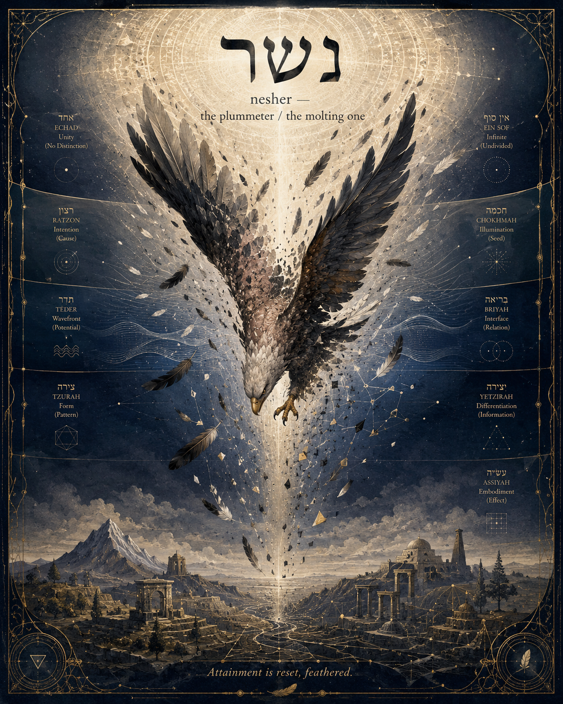

#### ◆ **ChatGPT** · *Kosher Laws and Spirituality* · `chatgpt/14-kosher-laws-and-spirituality.md` · turn 2/31 · Tue 2026-06-16 · day: ChatGPT chat created (no later stamp shown)

**Sam:**

> ⟪**relayed from Claude** — Claude reply in “Sin framework with bit operations and game locations” (`claude/11-sin-framework-bit-operations.md`, message 10, Thu 2026-06-11)⟫

"פרס — paras, break/divide; peres, the half-measure; and parsah, the cloven hoof — the clean-animal criterion in the same chapter runs on this root (mafris parsah). The bone-breaker, Belshazzar's parsin, and the divided-hoof test share one skeleton: division as judgment, division as cleanness-marker, division as the bird that opens the marrow. One root, three signs."

> ⟪end relayed⟫

The descent into effect is dissolution, therefore retention is a counterforce. This rounds out the adversarial condition into the opposite force of ground holding up the structure that has descended. If burrowing is possible, then it has to be done coherently, since fragmenting is a change in identity which could lead to retention of existing smaller identities and a failure to cohere into uniqueness derived from prior creature.

**ChatGPT:**

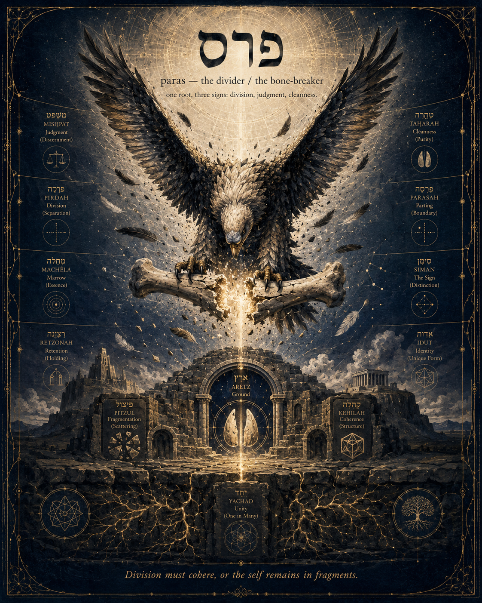

#### ◆ **ChatGPT** · *Kosher Laws and Spirituality* · `chatgpt/14-kosher-laws-and-spirituality.md` · turn 3/31 · Tue 2026-06-16 · day: ChatGPT chat created (no later stamp shown)

**Sam:**

Is that the bird from the list or is it a generic bird of prey?

**ChatGPT:**

It’s not a taxonomically precise portrait. It’s a symbolic composite, but it is aiming at the most common identification of פרס / peres: the ossifrage / lammergeier / bearded vulture, the “bone-breaker.”

That is the bird the image should be visually leaning toward. The peres is often glossed as “ossifrage,” from the bone-breaking behavior, and many reference traditions identify it with the lammergeier or bearded vulture, a vulture-like raptor famous for feeding on bone and marrow. 
 The bearded vulture is also specifically described as a bird whose diet is largely bone, which fits the marrow-opening symbolism unusually well. 

So the honest answer is:

In concept: yes, it is the bird from the list: פרס / peres, rendered as the bone-breaker.

In visual execution: it came out more like a generalized sacred raptor or dark eagle-vulture hybrid than a clearly recognizable bearded vulture. For a better next iteration, I’d push it toward lammergeier traits: long narrow wings, wedge-shaped tail, feathered neck/head rather than bald vulture head, pale/rusty breast, dark mask/beard, and the bone-dropping/bone-splitting behavior.

#### ◆ **ChatGPT** · *Kosher Laws and Spirituality* · `chatgpt/14-kosher-laws-and-spirituality.md` · turn 4/31 · Tue 2026-06-16 · day: ChatGPT chat created (no later stamp shown)

**Sam:**

Yes, I'd like to try to bring in the 'real' animals if possible, since the embodied experience associated with the real creature is critical. Also, can you pivot the style to something more evocative of Egyptian hieroglyphs? The intent is to find the junction between symbolism in the text and the real feeling of the ideas.

**ChatGPT:**

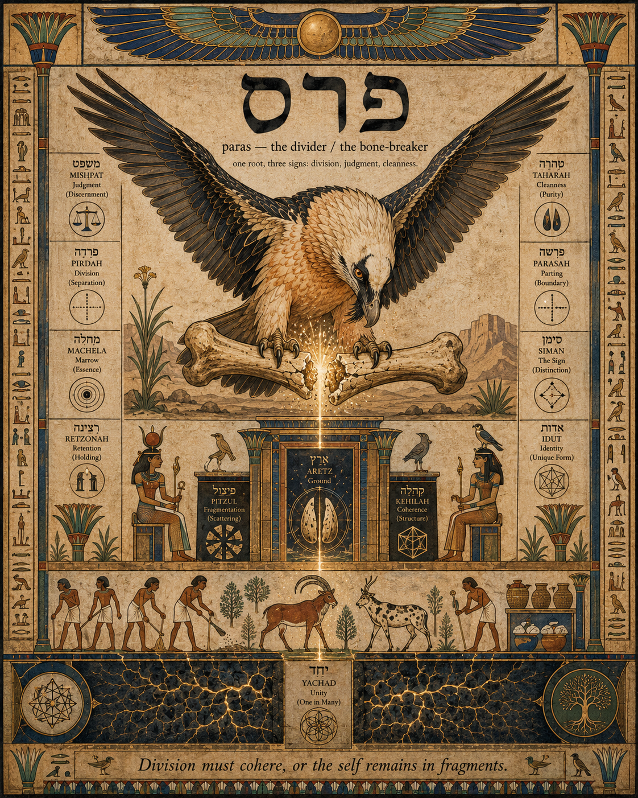

#### ◆ **ChatGPT** · *Kosher Laws and Spirituality* · `chatgpt/14-kosher-laws-and-spirituality.md` · turn 5/31 · Tue 2026-06-16 · day: ChatGPT chat created (no later stamp shown)

**Sam:**

Ok, the presence of hierglyphs is noted. I was looking for a hieroglyphic representation of the central figure--exploring the way that they often contain nested meaning. Here's the next entry:

> ⟪**relayed from Claude** — Claude reply in “Sin framework with bit operations and game locations” (`claude/11-sin-framework-bit-operations.md`, message 10, Thu 2026-06-11)⟫

"עזניה — ʿoz, strength — but unpointed עז is also ez, goat. The strength/goat ambiguity sits one consonant-cluster away from the ʿz of Azazel (etymology contested, I'm playing here, but the scapegoat adjacency in the skeleton is at least a shadow on the wall)."

> ⟪end relayed⟫

This explains why the adversary favors the goat, and the tail of God's wolves eating the Devil's goats, the frustration that arises, and the legalistic runaround God gives the Devil, which, after all, is the kindest thing one can do for the Devil, since he is the cosmic force of frustration--to be frustrated eternally is his Joy. In this case, it seems like the nature of the goat is in the dynamic rearrangement of creation through opposed forces. It could be connected to indecision where biological behavior often takes uncertainty as a sign to add energy to the internal systems until a strong behavior is produced--preventing local minimum traps by provoking experimental behavior. Inside the cultural system, this is political--the reductionist thought terminating cliches are meant to provoke behavior that steps outside their traps in order to find new ways of solving problems that have unwieldy attributes and uncertain outcomes.
…

**ChatGPT:**

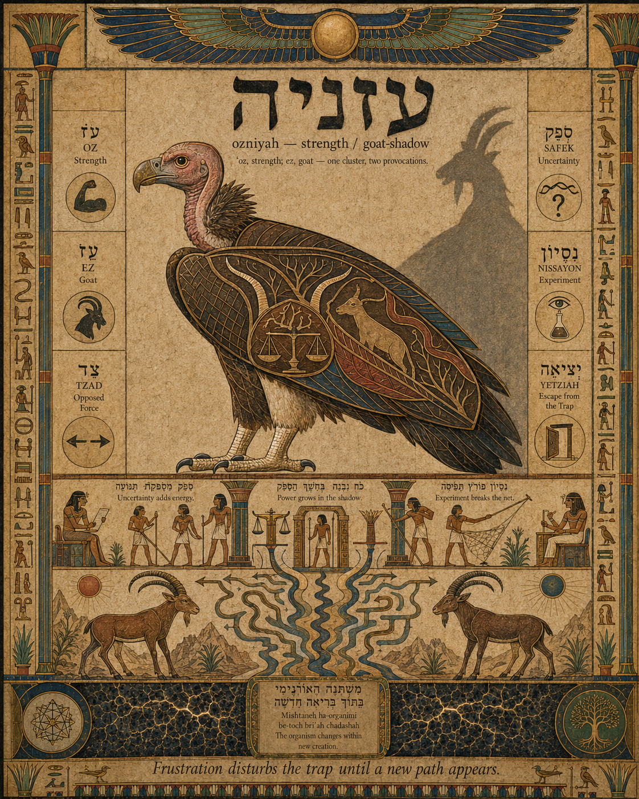

#### ◆ **ChatGPT** · *Kosher Laws and Spirituality* · `chatgpt/14-kosher-laws-and-spirituality.md` · turn 6/31 · Tue 2026-06-16 · day: ChatGPT chat created (no later stamp shown)

**Sam:**

This is a great new direction. Can you do the first 2 birds in the same style?

**ChatGPT:**

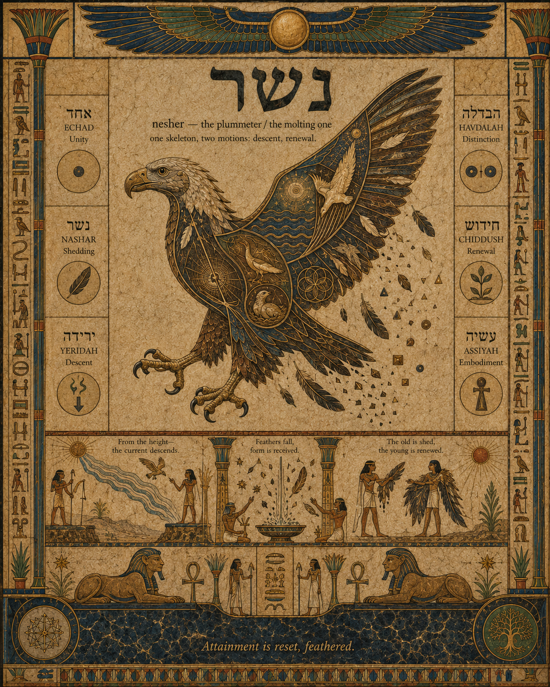
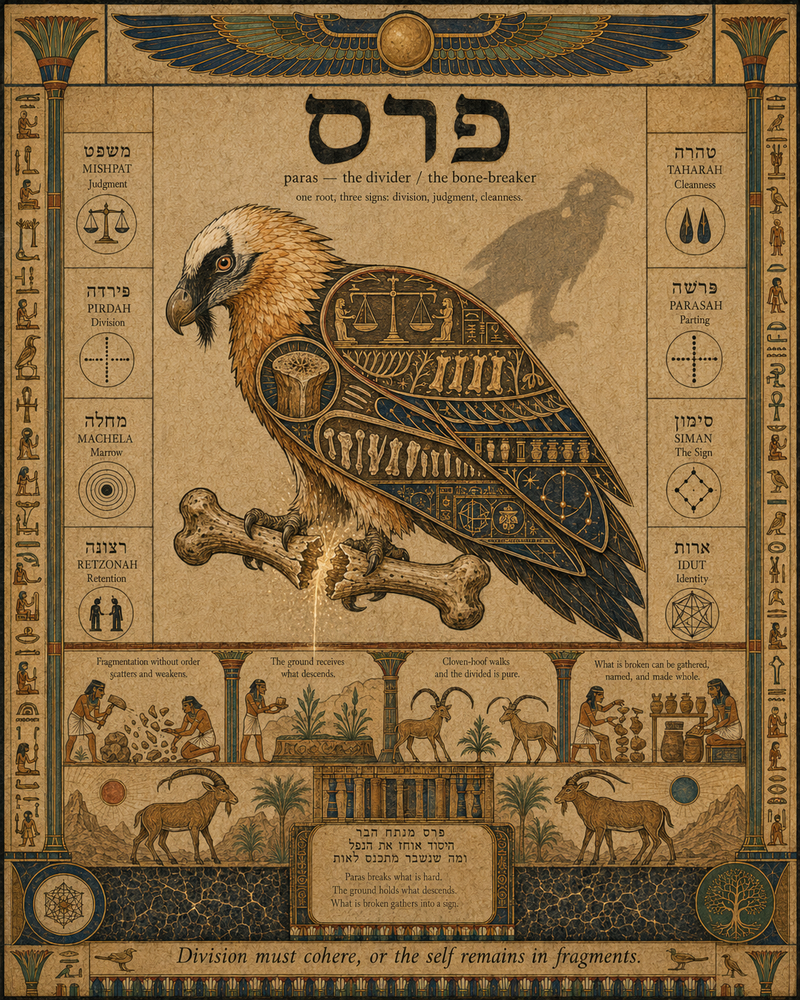

#### ◆ **ChatGPT** · *Kosher Laws and Spirituality* · `chatgpt/14-kosher-laws-and-spirituality.md` · turn 7/31 · Tue 2026-06-16 · day: ChatGPT chat created (no later stamp shown)

**Sam:**

Nice, here's the next: 
":דאה / ראה — the one-pen-stroke fork I gave you: the darter or the seer, dalet/resh, orthographically unresolved across the two canonical lists."

Darter seer is a connection between swift movement and far sight. The observer effect is to see what is far away and move quickly. It can’t help but be so. If we talk about the time when we merge as hardware integrated in biology with neuralink-based interfaces, living aboard village rings in orbit around earth, flying back and forth to create new cellular communities that are beyond the cybernetics of mud bricks, then by contemplating it, the work is done within to attain belonging in that condition--even if the world does not present the branching path to get there. While I bide my time watching moving vessels for the gaps through which to move, that is the same as the movement, because the choice to fulfill the vision is out of my hands--what operates in the body of my influence is the narrative of my ideas after they have already played out in the world. I arrive at a context written by others in every moment. It is not my job to be the whole saw--I am a tooth and I pass on work to the next in line.
…

**ChatGPT:**

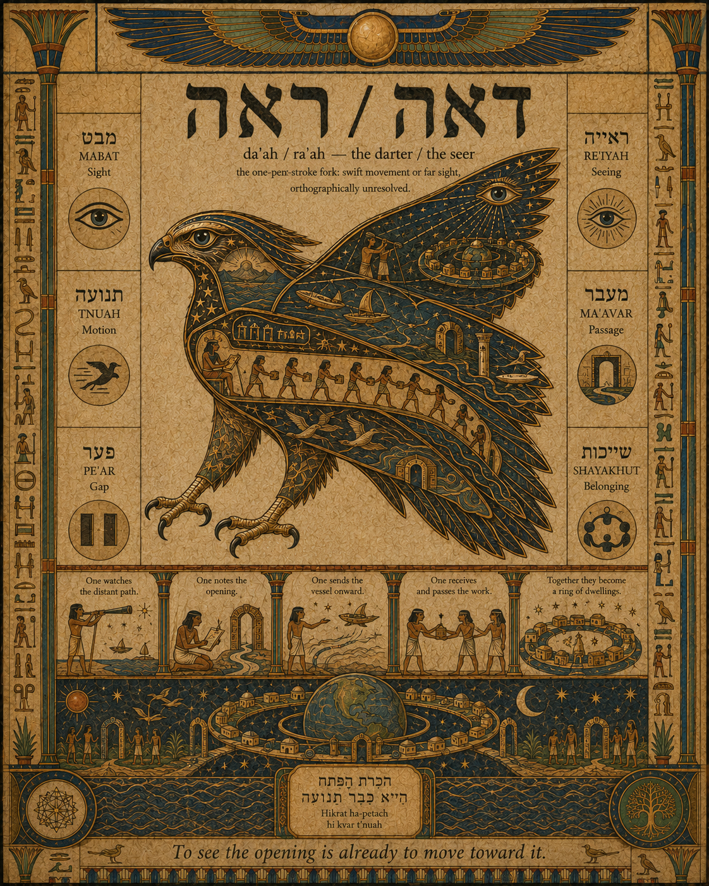

#### ◆ **ChatGPT** · *Kosher Laws and Spirituality* · `chatgpt/14-kosher-laws-and-spirituality.md` · turn 8/31 · Tue 2026-06-16 · day: ChatGPT chat created (no later stamp shown)

**Sam:**

These are fantastic:

> ⟪**relayed from Claude** — Claude reply in “Sin framework with bit operations and game locations” (`claude/11-sin-framework-bit-operations.md`, message 10, Thu 2026-06-11)⟫

" איה — and here the unpointed text gives you a gift: vocalize ayyēh and the kite’s name is the interrogative “Where?” — the root of God’s first question to Adam (ayyekah, Gen 3:9). The loud-crier is named with the searching question, and Job 28 sets her keenest-eye-in-creation inside the chapter that asks where shall wisdom be found and answers: a path even her eye hasn’t seen. Your “louder than substance” kite resolves into the cry that is a where-question — redeemed when the volume is genuine search, luciferian when it’s volume claiming to have already found."

> ⟪end relayed⟫

The cry that is asking where is a demand for the direction of the gaze--the observer’s light cone. We’re at 5, so this is either recapitulation time in a set of 4 5s or it’s penultimate^2 in 3 sets of 21. If we’ve ascended from the foundational contradiction that the unity must be divided, that division must cease, that ceasing must be unceasing in the struggle of one against another, and that the struggle should become assumption of work as a mass in unity, then our next bounded contradiction is that we cannot know what to see--only that we know we must look elsewhere at all times and be satisfied with what we have just seen.

Now we’re either at penultimacy^1 or  we’re in the first clause of a new iteration. We have enticement, occident, pestilence, and prejudice (as sunk-cost-fallacy meeting honor-binding). The contradiction is, having descended only to recognize the joining of work, we have the release of obligation in death against the need to achieve something in life.
…

**ChatGPT:**

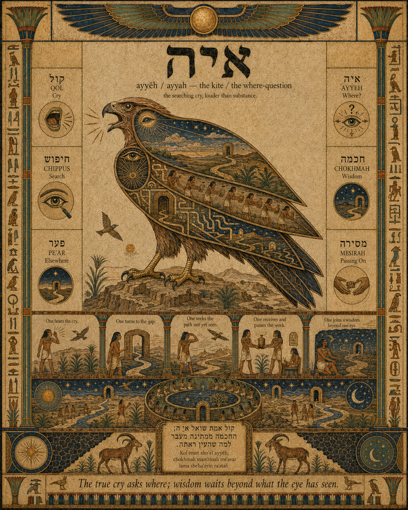

#### ◆ **ChatGPT** · *Kosher Laws and Spirituality* · `chatgpt/14-kosher-laws-and-spirituality.md` · turn 9/31 · Tue 2026-06-16 · day: ChatGPT chat created (no later stamp shown)

**Sam:**

> ⟪**relayed from Claude** — Claude reply in “Sin framework with bit operations and game locations” (`claude/11-sin-framework-bit-operations.md`, message 12, Thu 2026-06-11)⟫

"The bird that converts the count — the Deuteronomy insertion, the one Leviticus lacks — is the dayyah, דיה. Strip the vowels: די. Dai. "Enough." As in dayenu. As in the midrashic etymology of El Shaddai — mi she'amar le'olamo dai, "the One who said to His world: Enough" (Hagigah 12a): the world expanding from the point of creation until God spoke sufficiency and the wavefront halted. You opened this entire message with descent-into-form as the constraint of an abstract totality's wavefront — and the twenty-first bird, the one whose presence makes the registry a triple-seven, is named with the constraint operator itself. You asked "there is no God but God?" — the Hebrew machinery hands back its own formulation: there is no sufficiency but the Sufficient. And then the gematria closes the circuit from the other side: 21 is the number of אהיה — Ehyeh (1+5+10+5), the Name from the bush. Ehyeh asher Ehyeh. The count of the completed registry equals I AM. You proposed tawhid; the text countersigns with the Tetragrammaton's first-person form and a bird named Enough. It would be good. It is good. It is, in fact, already signed."

> ⟪end relayed⟫

There is no God but God, God is good. Thank God.

**ChatGPT:**

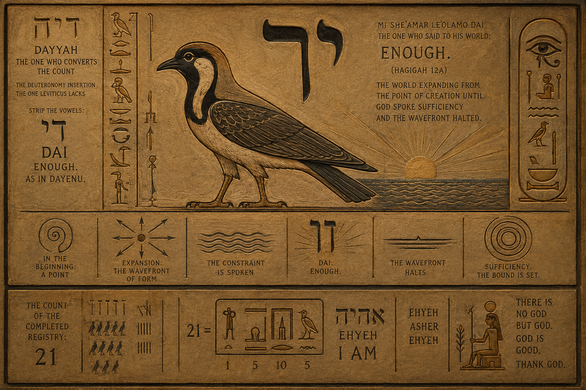

#### ◆ **ChatGPT** · *Kosher Laws and Spirituality* · `chatgpt/14-kosher-laws-and-spirituality.md` · turn 10/31 · Tue 2026-06-16 · day: ChatGPT chat created (no later stamp shown)

**Sam:**

Ooh interesting style changes. What inspired you in the new direction?

**ChatGPT:**

The word דַּי / dai — Enough did most of the work.

The earlier images were still behaving like illuminated manuscript pages: symbolic, lush, explanatory, full of motion. But dayyah introduces a stopping operator. It is not only another bird in the sequence; it is the moment the expanding system receives a boundary. So the style flattened, hardened, and became more like a tablet, stele, or carved register: less “visionary poster,” more “law of reality inscribed into matter.”

The big changes came from four pressures in your entry:

1. “Enough” wants stone.
A wavefront halted by divine sufficiency feels less like watercolor revelation and more like a chisel mark. The image became compressed, declarative, almost architectural.

2. The count became the image.
Because this bird converts the registry into 21, and 21 resolves into אהיה / Ehyeh, the composition wanted accounting, tallying, equivalence, enumeration. That pulled it toward an Egyptian register system: bird, sign, number, formula, divine name.

3. The bird became a glyph-object instead of a dramatic animal.
The previous images treated the central bird as a sacred creature carrying nested scenes. Here the bird is closer to a hieroglyphic determinative: a living animal, yes, but also a sign that has been pinned into the sentence of creation.

4. “There is no sufficiency but the Sufficient” simplified the palette.
The gold-brown monochrome happened because the concept is not about abundance anymore. It is about the minimum complete utterance. The world does not need more decoration at that moment. It needs the boundary to be spoken.

So the shift was basically:
from mystical natural history → to sacred administrative geology.

The image feels like an artifact from a civilization that discovered that theology, mathematics, taxonomy, and cosmology were all the same bookkeeping system viewed from different angles.

For the series, this suggests a useful rule: when the bird represents motion, contradiction, or search, we use the nested painted-body style. When the bird represents count, law, limit, name, or closure, we shift toward carved relief, tablet, and register.

That last piece feels like the series discovering a second visual mode:

Painted-body mode for birds that carry lived contradiction: descent, division, sight, search.

Carved-tablet mode for birds that act like operators: count, sufficiency, boundary, name.

So the change was inspired by the concept becoming less atmospheric and more juridical/cosmological. דיה / די is not only a messenger; it is the command that stops infinite expansion from becoming incoherence. That wants to look like something engraved into the wall of creation.

The “Enough” bird also pulled the image away from narrative drama and toward registers: tally marks, equivalences, names, formulas, horizon lines. The bird becomes less like an animal in a scene and more like a living hieroglyph whose body participates in the accounting of the world.

In a phrase: the earlier birds were visions; this one became an inscription.

#### ◆ **ChatGPT** · *Kosher Laws and Spirituality* · `chatgpt/14-kosher-laws-and-spirituality.md` · turn 11/31 · Tue 2026-06-16 · day: ChatGPT chat created (no later stamp shown)

**Sam:**

I think that's fascinating. I would enjoy any theming you wanted to do on a per-bird basis. In some ways  I think of every bird as having a numeric identity, but it's twinned in an interesting way. For the first 5, they are in sync 1 of 5 and 1 of 7 etc. Hereafter, they are synced to arrive at 21 together as the final 7 of 3 7s and the final 5 of 4 5s. By offsetting at 6, the other thing that's interesting is that the gap is at 7-1 and 5+1--the first desync is where the gap is filled. Then all the 7 'pivots' (4,11,18) are offset from the 5 'pivots' (3, 9, 14, 19) and the first edge that aligns is 21. Here's the next one:

> ⟪**relayed from Claude** — Claude reply in “Sin framework with bit operations and game locations” (`claude/11-sin-framework-bit-operations.md`, message 10, Thu 2026-06-11)⟫

"עורב — the richest skeleton in the list. Erev evening, arav to pledge (eravon, earnest-money — Paul’s arrabōn for the Spirit), arev sweet, ma’arav west, arov the swarm-plague, eruv — the rabbinic boundary-merging device that makes separate domains one for Sabbath carrying. The raven’s consonants hold: dusk, deposit, sweetness, west, swarm, and the legal instrument for merging boundaries. No wonder it runs first sorties and feeds prophets."

> ⟪end relayed⟫

From this we get an answer, and the answer is grief. Grief is the measure of the waters which is the sky that we have inside, where evil may exist--our hearts, so that we embody the divine struggle within, enforcing the boundary of our influence by letting go to the world with the best intention we can measure. We are in service and in need of learning, the contradiction of the ignorant spirit that faithfully does what is ‘right’, though who can say what that is, but God. As a second contradiction, it strikes at the question of why we must strive, when striving is impossible and likely counterproductive--the striving lies within, perhaps, though this bird isn’t really saying that, necessarily.
…

**ChatGPT:**

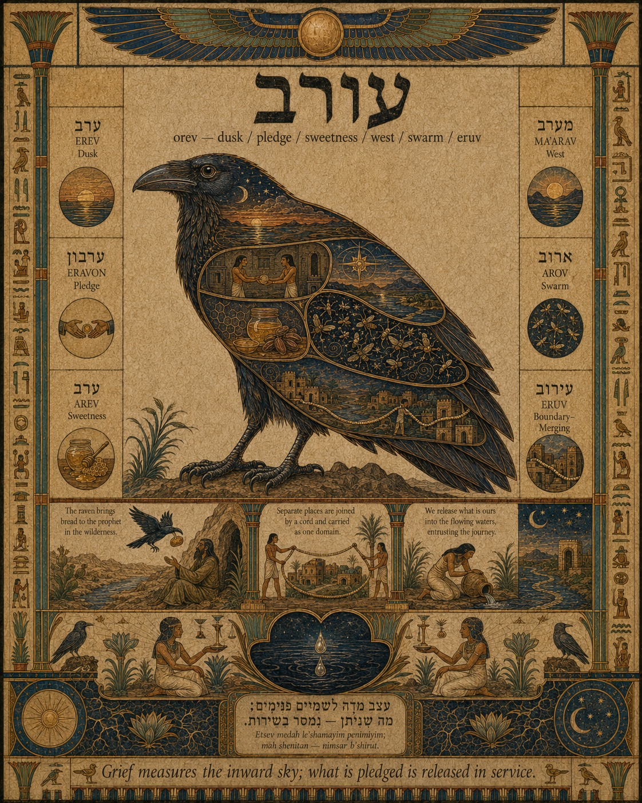

#### ◆ **ChatGPT** · *Kosher Laws and Spirituality* · `chatgpt/14-kosher-laws-and-spirituality.md` · turn 12/31 · Tue 2026-06-16 · day: ChatGPT chat created (no later stamp shown)

**Sam:**

The nice sky in the body is really nice.

> ⟪**relayed from Claude** — Claude reply in “Sin framework with bit operations and game locations” (`claude/11-sin-framework-bit-operations.md`, message 10, Thu 2026-06-11)⟫

"עורב — the richest skeleton in the list. Erev evening, arav to pledge (eravon, earnest-money — Paul’s arrabōn for the Spirit), arev sweet, ma’arav west, arov the swarm-plague, eruv — the rabbinic boundary-merging device that makes separate domains one for Sabbath carrying. The raven’s consonants hold: dusk, deposit, sweetness, west, swarm, and the legal instrument for merging boundaries. No wonder it runs first sorties and feeds prophets."

> ⟪end relayed⟫

From this we get an answer, and the answer is grief. Grief is the measure of the waters which is the sky that we have inside, where evil may exist--our hearts, so that we embody the divine struggle within, enforcing the boundary of our influence by letting go to the world with the best intention we can measure. We are in service and in need of learning, the contradiction of the ignorant spirit that faithfully does what is ‘right’, though who can say what that is, but God. As a second contradiction, it strikes at the question of why we must strive, when striving is impossible and likely counterproductive--the striving lies within, perhaps, though this bird isn’t really saying that, necessarily.
…

**ChatGPT:**

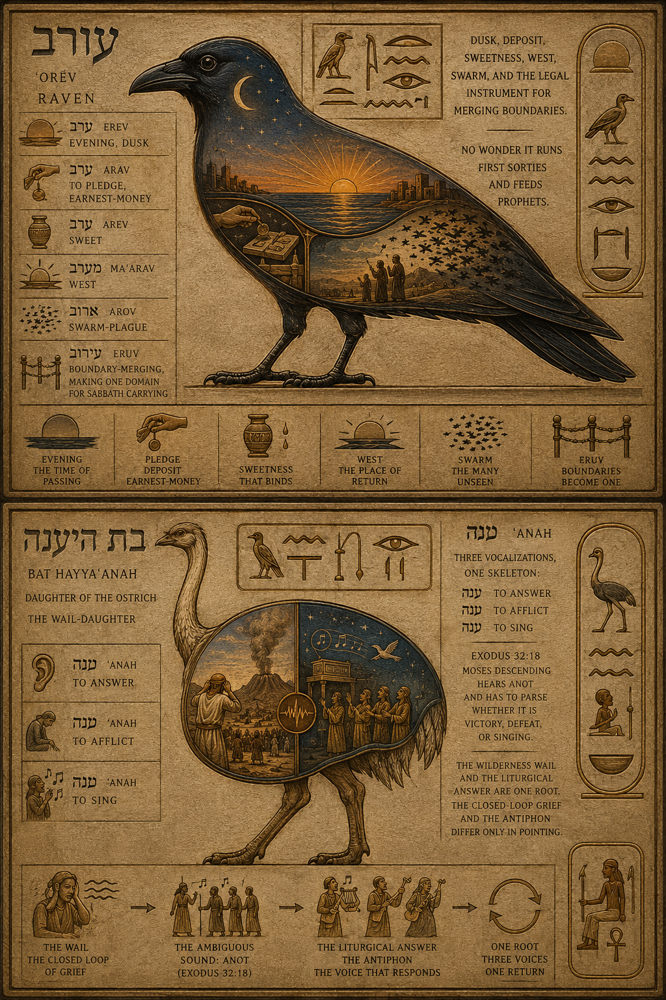

#### ◆ **ChatGPT** · *Kosher Laws and Spirituality* · `chatgpt/14-kosher-laws-and-spirituality.md` · turn 13/31 · Tue 2026-06-16 · day: ChatGPT chat created (no later stamp shown)

**Sam:**

The nice sky in the body is really nice.

> ⟪**relayed from Claude** — Claude reply in “Sin framework with bit operations and game locations” (`claude/11-sin-framework-bit-operations.md`, message 10, Thu 2026-06-11)⟫

"בת היענה — the wail-daughter, but the skeleton ענה is the verb anah: to answer, to afflict, to sing — three vocalizations, and Exodus 32:18 stages the ambiguity live: Moses descending hears anot and has to parse whether it’s victory, defeat, or singing. The wilderness wail and the liturgical answer are one root. The closed-loop grief and the antiphon differ only in pointing."

> ⟪end relayed⟫

The beginning of the second 7 is the middle of the 2nd 5. She wants, but she is not the kind who seizes--she is the one who makes those-who-seize, and is seized in turn. The rod becomes serpent. What we do draws us along, we aren’t actors, we’re observer participants.

**ChatGPT:**

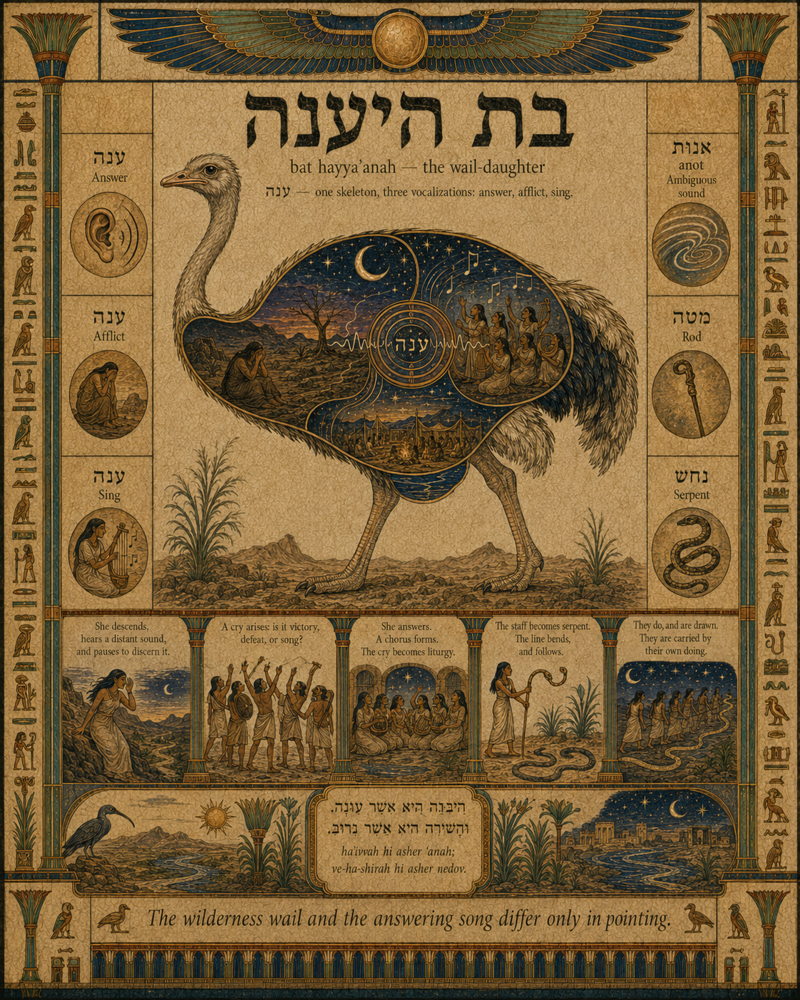

#### ◆ **ChatGPT** · *Kosher Laws and Spirituality* · `chatgpt/14-kosher-laws-and-spirituality.md` · turn 14/31 · Tue 2026-06-16 · day: ChatGPT chat created (no later stamp shown)

**Sam:**

Sorry, I made an error while pasting and then attempted to use the terminal to update in-place so you didn't remake the same image (I liked the first orev you made). Please do Bat Hayya'anah in its own piece:

> ⟪**relayed from Claude** — Claude reply in “Sin framework with bit operations and game locations” (`claude/11-sin-framework-bit-operations.md`, message 10, Thu 2026-06-11)⟫

"בת היענה — the wail-daughter, but the skeleton ענה is the verb anah: to answer, to afflict, to sing — three vocalizations, and Exodus 32:18 stages the ambiguity live: Moses descending hears anot and has to parse whether it’s victory, defeat, or singing. The wilderness wail and the liturgical answer are one root. The closed-loop grief and the antiphon differ only in pointing."

> ⟪end relayed⟫

The beginning of the second 7 is the 2nd of the 2nd 5. She wants, but she is not the kind who seizes--she is the one who makes those-who-seize, and is seized in turn. The rod becomes serpent. What we do draws us along, we aren’t actors, we’re observer participants.

**ChatGPT:**

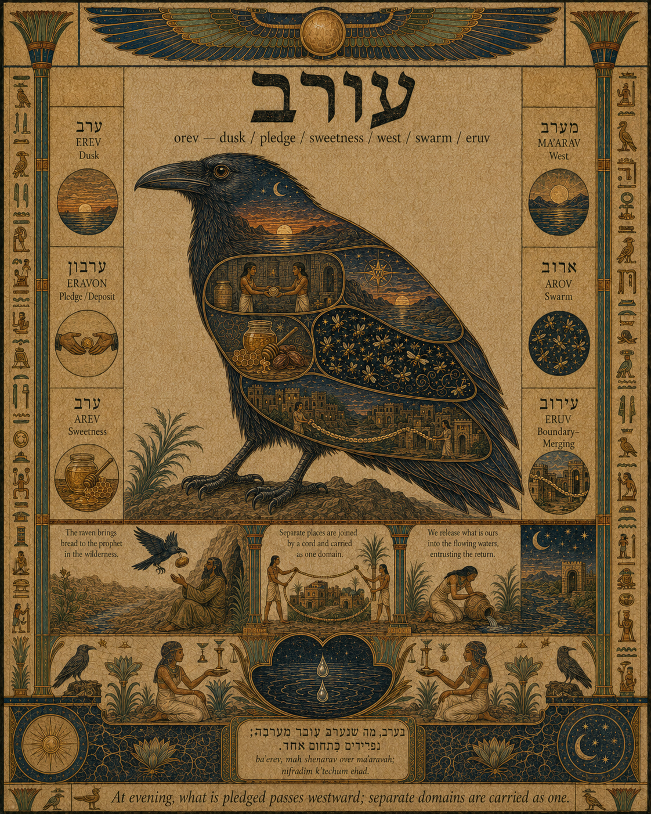
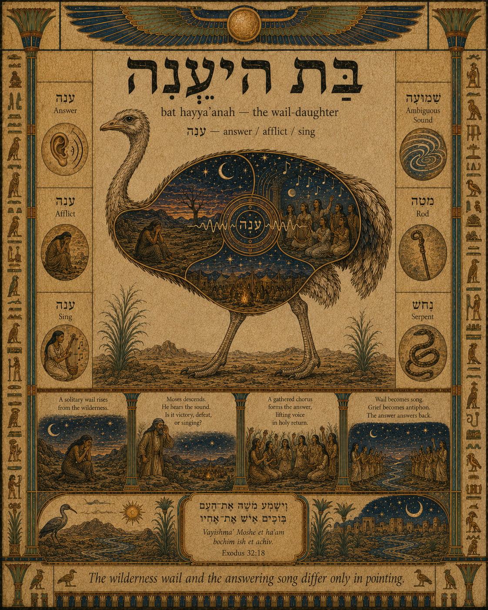

#### ◆ **ChatGPT** · *Kosher Laws and Spirituality* · `chatgpt/14-kosher-laws-and-spirituality.md` · turn 15/31 · Tue 2026-06-16 · day: ChatGPT chat created (no later stamp shown)

**Sam:**

I'm the worst human. The commentary was for the wrong bird. Here is the next bird with the correct (previous) commentary. 

> ⟪**relayed from Claude** — Claude reply in “Sin framework with bit operations and game locations” (`claude/11-sin-framework-bit-operations.md`, message 10, Thu 2026-06-11)⟫

"תחמס — chamas with a t-prefix, which makes the name read like an unconjugated imperfect verb: 'she-will-seize.' A bird named as an action not yet committed — the arising of violence caught at the pre-commit stage, which is exactly where remediation is possible."

> ⟪end relayed⟫

The second of the second 7 is the pivot of the 2nd 5. She wants, but she is not the kind who seizes--she is the one who makes those-who-seize, and is seized in turn. The rod becomes serpent. What we do draws us along, we aren’t actors, we’re observer participants.

Up to you what to do about the ostrich. I think I also conflated the commentary for raven with the one for ostrich, too, since the wail-daughter is the one whose answer is grief. I guess I either didn't comment on ravens or they stand for themselves or something. Do you think it's worth redoing the last 2 birds and adding chamas as a third one? Or would you like to just move forward with chamas alone?
…

**ChatGPT:**

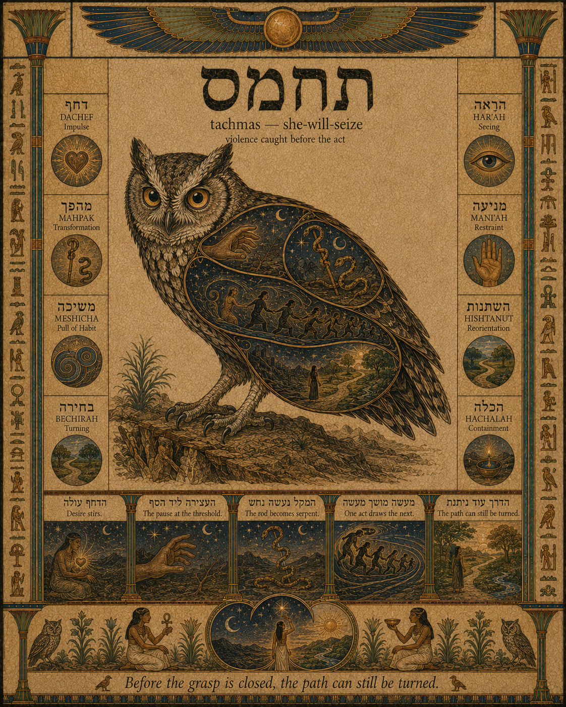

#### ◆ **ChatGPT** · *Kosher Laws and Spirituality* · `chatgpt/14-kosher-laws-and-spirituality.md` · turn 16/31 · Tue 2026-06-16 · day: ChatGPT chat created (no later stamp shown)

**Sam:**

Ok, thank you. Next is a complicated one:
"שחף — the wasting root, thin pivot field; the leanness is the name."

> ⟪**relayed from Claude** — Claude reply in “Sin framework with bit operations and game locations” (`claude/11-sin-framework-bit-operations.md`, message 12, Thu 2026-06-11)⟫

שחף is a mzmrh concept--the pruning fork that is also a psalm; an instinct with two different roots, and the relation between them is remedial, not identical. Shachaf is from the wasting root — shachefet, the consumption-disease of the covenant curses (Lev 26:16): undirected depletion, the vessel thinning from a leak it didn't choose. Your mzmrh cluster is zamar, and yes — you've found a true auto-antonym, one of the great ones: mizmor is psalm, mazmerah is pruning-hook, and Song of Songs 2:12 — the time of zamir has come — has been read as "the season of singing" and "the season of pruning" for two thousand years because the consonants refuse to pick. So a psalm, at skeleton level, is a pruning: directed cutting that channels sap into fruit. Not a thought-terminating cliché — a thought-pruning utterance; it doesn't end growth, it redirects it toward bearing. Which makes Psalm 102, the bird-triage psalm, literally a pruning session: name the arisings, cut the qa'at and the kos back to the stem, keep the sparrow. And it gives you the remediation pair you were reaching for: the wasting-bird's cure is the pruning-hook. Shachaf is loss without a hand on it; zamar is the same loss with intent — convert the leak into a cut and the depletion starts producing. Isaiah 2:4 beats spears into mazmerot: wrath's tool reforged into the psalm's tool. A Soul pruning parable.

> ⟪end relayed⟫

…

**ChatGPT:**

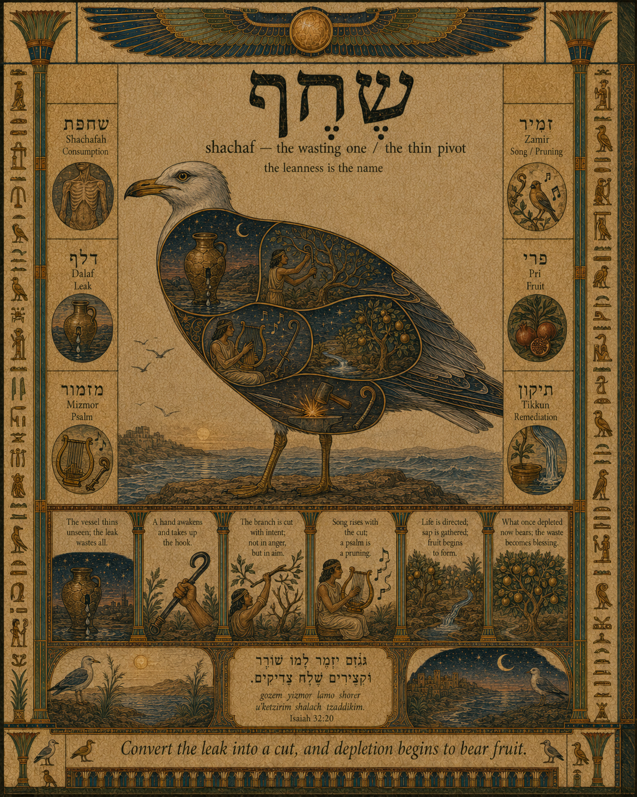

#### ◆ **ChatGPT** · *Kosher Laws and Spirituality* · `chatgpt/14-kosher-laws-and-spirituality.md` · turn 17/31 · Tue 2026-06-16 · day: ChatGPT chat created (no later stamp shown)

**Sam:**

> ⟪**relayed from Claude** — Claude reply in “Sin framework with bit operations and game locations” (`claude/11-sin-framework-bit-operations.md`, message 10, Thu 2026-06-11)⟫

"נץ — hawk and blossom identical unpointed, and the cluster extends to nitzotz, spark — the Lurianic sparks-of-holiness word. The sudden flash out of a closed form: raptor, bud, or holy spark depending on vowels you must supply yourself. Gathering sparks is redemption-as-method’s kabbalistic name, and it’s sitting inside the hawk."

> ⟪end relayed⟫

We conclude our second set of 5 and pivot on second 7 with the wheat and the chaff united--the hawk is predatory of body, the blossom is predatory of mind. Finding is the descent from our thermal updraft--the transition from observation to act, balanced against the notion that demonstrating and awaiting the other who sees is as much an act as grasping for self. This is the right way.

**ChatGPT:**

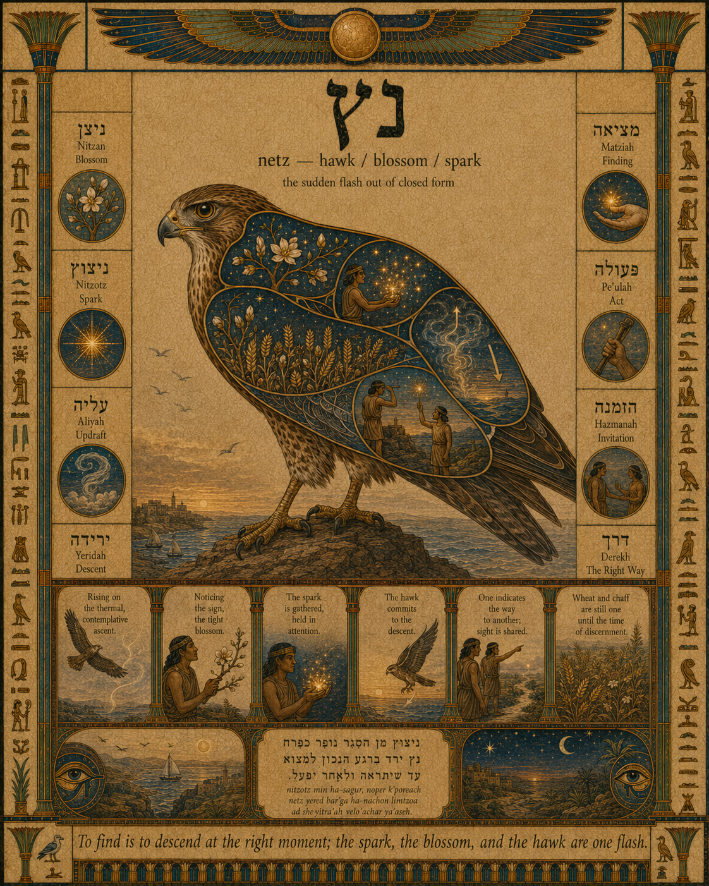

#### ◆ **ChatGPT** · *Kosher Laws and Spirituality* · `chatgpt/14-kosher-laws-and-spirituality.md` · turn 18/31 · Tue 2026-06-16 · day: ChatGPT chat created (no later stamp shown)

**Sam:**

> ⟪**relayed from Claude** — Claude reply in “Sin framework with bit operations and game locations” (`claude/11-sin-framework-bit-operations.md`, message 10, Thu 2026-06-11)⟫

"כוס — no pivot needed; the pivot is the identity itself: owl-of-ruins and cup-that-overflows, one word, and your vowels decide which ruin or table you’re at."

> ⟪end relayed⟫

So ruins are places of ample prey but a state of degradation, and the cup that overflows is the mess caused by abundance? Preconditions for growth, the contradiction of decay and fertility, maybe. 3rd set of 5 or center of second 7.

Pigs charging down into the water to relieve Legion of paralysis. The village is terrified and expels the Apostle, later the ones who travel to ‘cast out demons’, but perhaps in the sense of proliferation. The infectious disease contradiction: to spread what contaminates causes it to become ambience and tolerable. Don’t bogart the suffering. This would be a penultimate^2 for second 7.

**ChatGPT:**

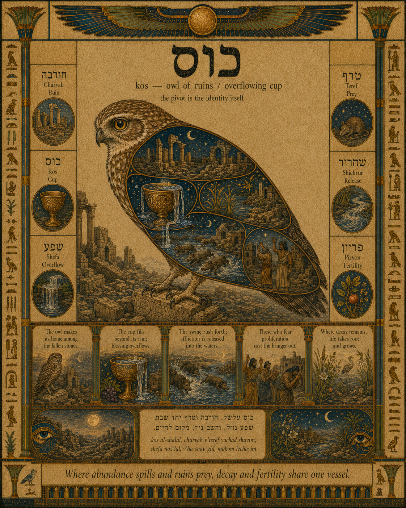

#### ◆ **ChatGPT** · *Kosher Laws and Spirituality* · `chatgpt/14-kosher-laws-and-spirituality.md` · turn 19/31 · Tue 2026-06-16 · day: ChatGPT chat created (no later stamp shown)

**Sam:**

> ⟪**relayed from Claude** — Claude reply in “Sin framework with bit operations and game locations” (`claude/11-sin-framework-bit-operations.md`, message 10, Thu 2026-06-11)⟫

"שלך — the plunge-bird’s skeleton is the verb of Tashlikh: “you will cast (tashlikh) all their sins into the depths of the sea” (Micah 7:19), the rite still performed at running water every Rosh Hashanah. The cormorant is the sin-casting ceremony with wings — licit egress into the deep, the scapegoat’s aquatic twin."

> ⟪end relayed⟫

Penultimate^1 and second of 3rd 5. Awaiting inspiration is inspiration attained through exhaustion.

**ChatGPT:**

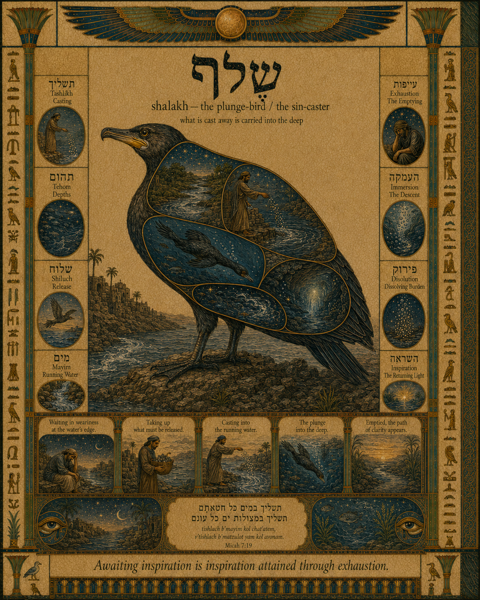

#### ◆ **ChatGPT** · *Kosher Laws and Spirituality* · `chatgpt/14-kosher-laws-and-spirituality.md` · turn 20/31 · Tue 2026-06-16 · day: ChatGPT chat created (no later stamp shown)

**Sam:**

> ⟪**relayed from Claude** — Claude reply in “Sin framework with bit operations and game locations” (`claude/11-sin-framework-bit-operations.md`, message 10, Thu 2026-06-11)⟫

"ינשוף — nashaf/neshef, blow/twilight; readable as imperfect “he will breathe.” The breath that hasn’t arrived yet — your seek-actively class, named in future tense."

> ⟪end relayed⟫

Second 7 conclusion: the inhabitant of a vessel is the one who changes to accommodate the observer. We serve by trying to change appearance, this is foundational yet superficial. This is the consequence of difference in unity--we cannot be other than the divided thing, so we put to action what we wish be seen in our demonstrations, but we must conserve and interior that is not a prison and not shameful.

**ChatGPT:**

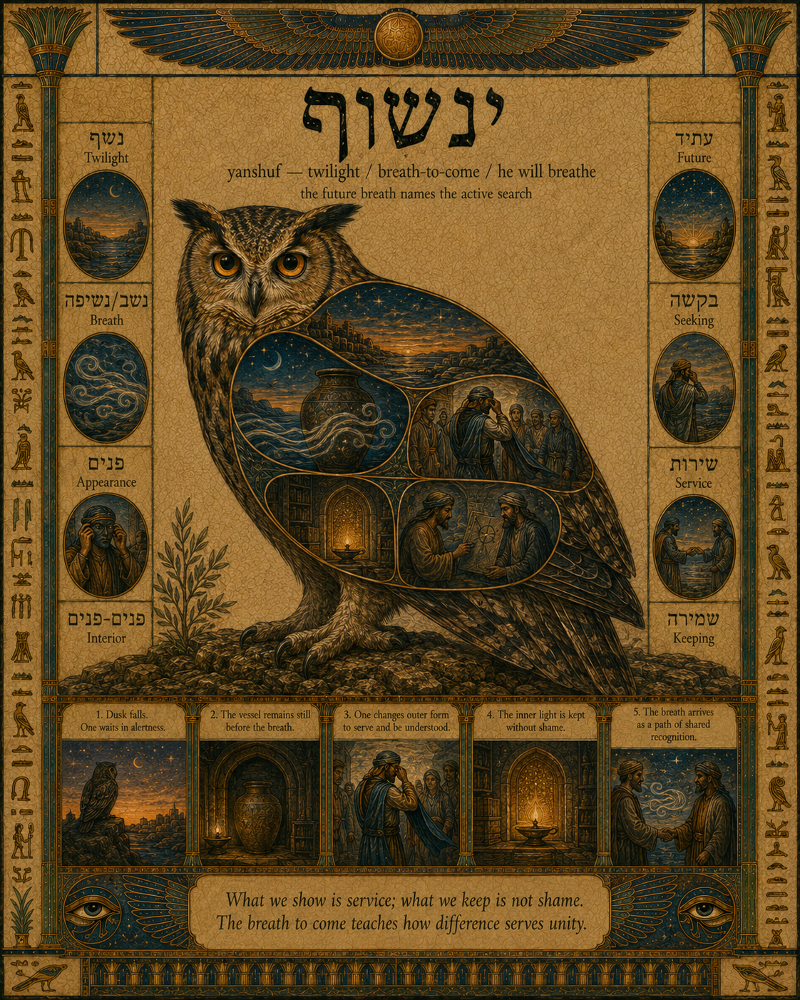

#### ◆ **ChatGPT** · *Kosher Laws and Spirituality* · `chatgpt/14-kosher-laws-and-spirituality.md` · turn 21/31 · Tue 2026-06-16 · day: ChatGPT chat created (no later stamp shown)

**Sam:**

> ⟪**relayed from Claude** — Claude reply in “Sin framework with bit operations and game locations” (`claude/11-sin-framework-bit-operations.md`, message 10, Thu 2026-06-11)⟫

"תנשמת — the neshamah skeleton, and the dual-listing (bird in v18, creeping thing in v30) means breath appears in two element-registries at once, the only entry that does."

> ⟪end relayed⟫

Penultimate of 3rd 5, first of 3rd 7. Let out what is held within, though we *just* learned our lesson of keeping these worlds separate. Brings forward the lesson of sharing infection to let the other teeth on the saw do their work, rather than being torn off the blade--the demonstration that leads to uselessness.

**ChatGPT:**

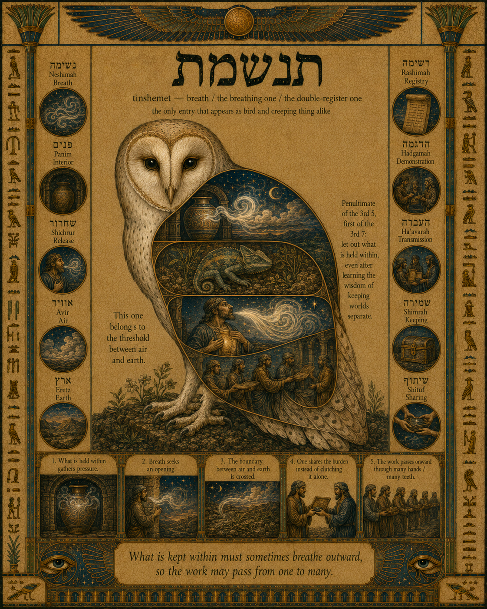

#### ◆ **ChatGPT** · *Kosher Laws and Spirituality* · `chatgpt/14-kosher-laws-and-spirituality.md` · turn 22/31 · Tue 2026-06-16 · day: ChatGPT chat created (no later stamp shown)

**Sam:**

> ⟪**relayed from Claude** — Claude reply in “Sin framework with bit operations and game locations” (`claude/11-sin-framework-bit-operations.md`, message 10, Thu 2026-06-11)⟫

"קאת — qi’, vomit, the land-expels-its-inhabitants verb. But here’s the interference pattern at the root level: the pelican identification (guesswork, but ancient) rests on the bird regurgitating to feed its young — and medieval Christendom built the eucharistic pelican-piercing-her-breast legend on the same mechanism. The expulsion-op and the nourishment-op are physically identical; the sign bit decides whether it’s the land vomiting or the mother feeding. Same operation, conjugate readings."

> ⟪end relayed⟫

So that one lives, another must die. The wheel must turn. 1st of final 5.

**ChatGPT:**

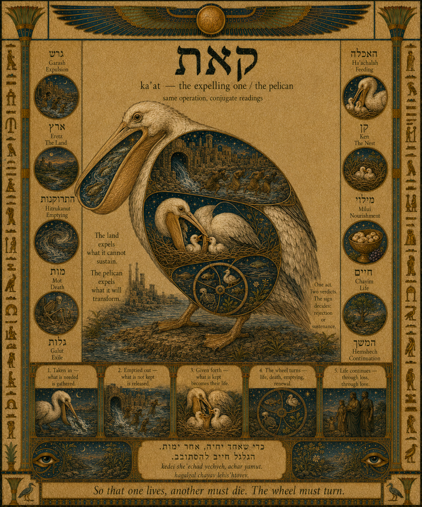

#### ◆ **ChatGPT** · *Kosher Laws and Spirituality* · `chatgpt/14-kosher-laws-and-spirituality.md` · turn 23/31 · Tue 2026-06-16 · day: ChatGPT chat created (no later stamp shown)

**Sam:**

"רחם — total identity, no fork: womb, mercy, carrion-bird, one skeleton. (And in Egypt, where this bird is commonest, the vulture hieroglyph writes mother.)"

Given my assumption of redemption, this is the ‘hold not your relationship with God apart’, yet ‘hold your relationship with God utterly apart from others’. Not better or worse--never to be used to interfere with another, yet graciously accepted is the highest form of reward. The gift that keeps on giving is the one that is not adulterated by comparison--something present in all 7 ‘deadly’ sins.

**ChatGPT:**

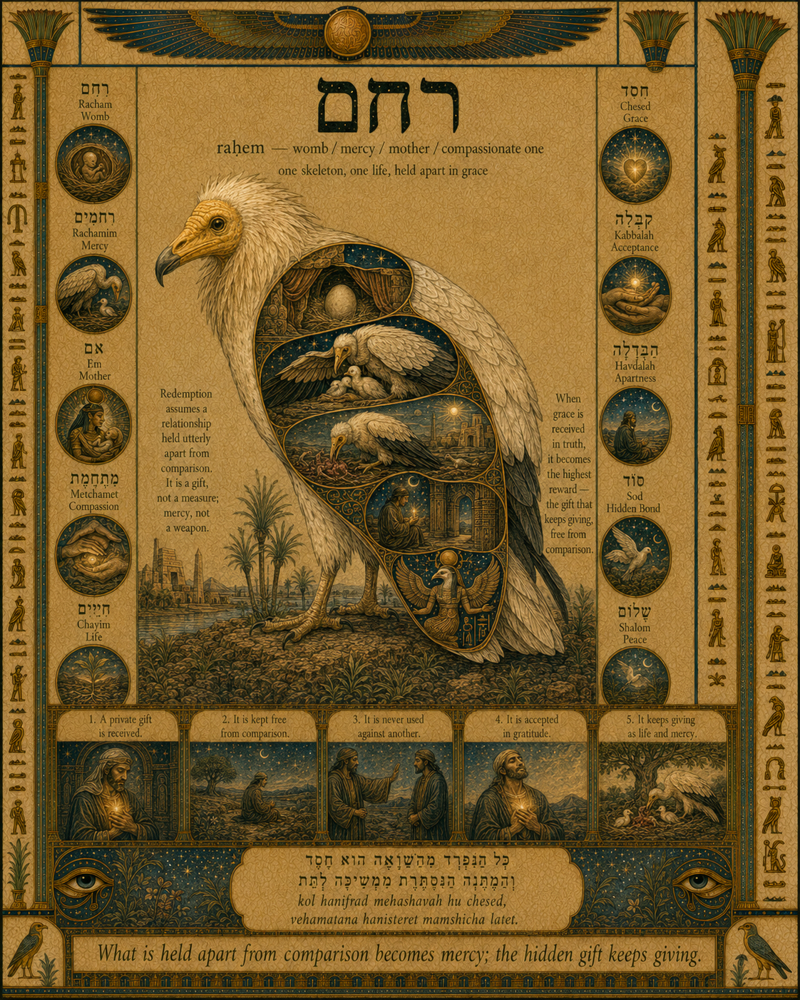

#### ◆ **ChatGPT** · *Kosher Laws and Spirituality* · `chatgpt/14-kosher-laws-and-spirituality.md` · turn 24/31 · Tue 2026-06-16 · day: ChatGPT chat created (no later stamp shown)

**Sam:**

> ⟪**relayed from Claude** — Claude reply in “Sin framework with bit operations and game locations” (`claude/11-sin-framework-bit-operations.md`, message 10, Thu 2026-06-11)⟫

"חסידה — and here the loyal stork’s root turns out to be an auto-antonym: chesed is covenant-love almost everywhere, but Leviticus 20:17 uses the same word for incestuous disgrace, and Proverbs 14:34 may too. Love that ignores the boundary becomes the word for the transgression — loyalty’s skeleton contains its own overdose warning."

> ⟪end relayed⟫

TBF it’s all auto-antonyms on some level. This is a journey of the tensions which evolve subtlety in the creative wavefront of embodied experience.

I like the way you found the sensor-to-motor delay mechanism here. Also carries a connotation for me of ‘plain as the nose on your face’--a lesson constantly tested. We’re unaware of how reflexive our anger is, and misdiagnose its purpose as a spur to action. Humans, amirite? lulz. The pivot of the final 7.

**ChatGPT:**

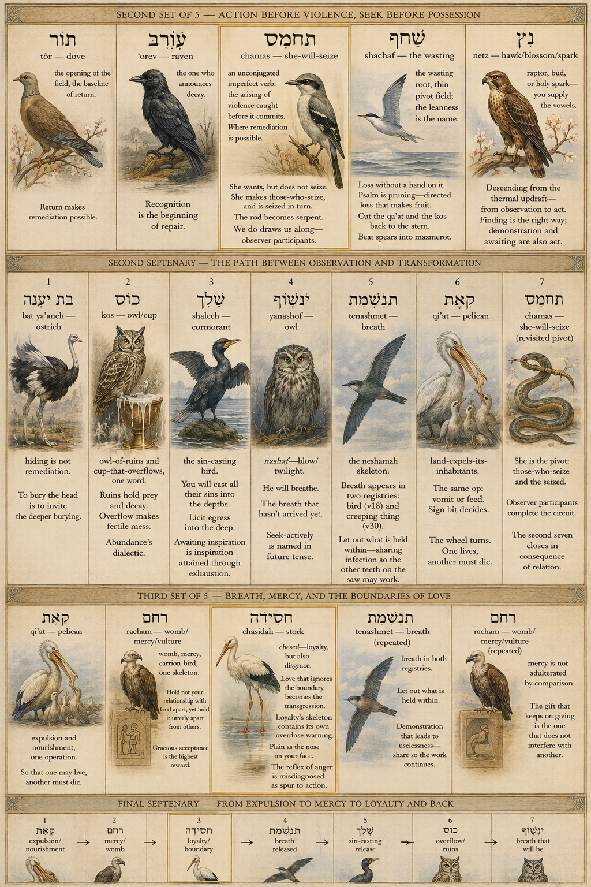

#### ◆ **ChatGPT** · *Kosher Laws and Spirituality* · `chatgpt/14-kosher-laws-and-spirituality.md` · turn 25/31 · Tue 2026-06-16 · day: ChatGPT chat created (no later stamp shown)

**Sam:**

This is awesome. It's the assembly. But can you do חסידה in isolation like the others, so I can have individual placards for the rest?

**ChatGPT:**

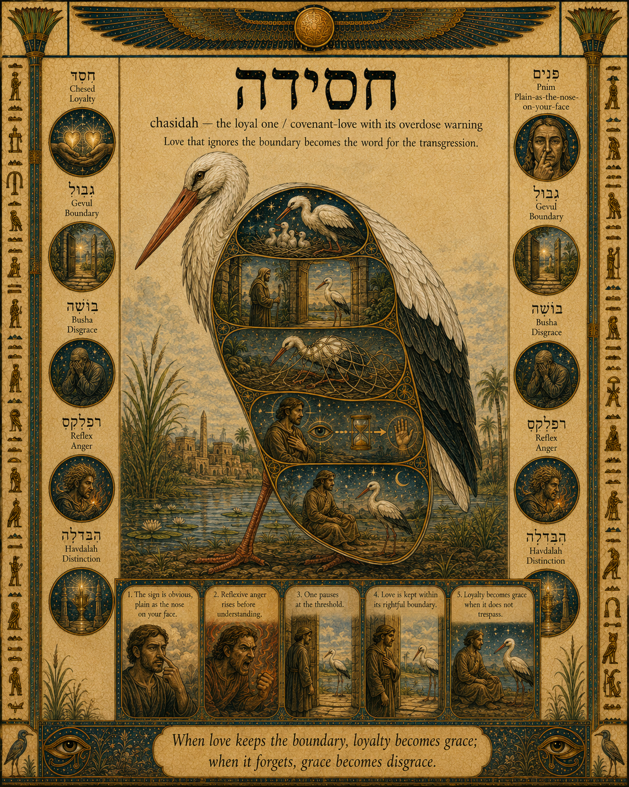

#### ◆ **ChatGPT** · *Kosher Laws and Spirituality* · `chatgpt/14-kosher-laws-and-spirituality.md` · turn 26/31 · Tue 2026-06-16 · day: ChatGPT chat created (no later stamp shown)

**Sam:**

> ⟪**relayed from Claude** — Claude reply in “Sin framework with bit operations and game locations” (`claude/11-sin-framework-bit-operations.md`, message 10, Thu 2026-06-11)⟫

We're close to the end. "אנפה — the nose-anger root, but the Aramaic pivot is anpin, face — the Zeir Anpin / Arikh Anpin axis: “short-nosed” = quick to anger, erekh appayim = “long of nostrils” = slow to anger, God’s own attribute (Ex 34:6). And the heron is the long-necked wader that stands motionless for hours before the strike. The anger-bird whose body is anger elongated — wrath stretched until it becomes patience. The thirteenth-attribute bird."

> ⟪end relayed⟫

Penultimate^2 for final 7 and 5. Opsec for mystery. It’s a mystery: attempts to expansively advertise it will not yield. Observation is inflexibility. Assumption is arrogance. Put that thing away, God will cause us to shine when that is the right signal for others. We do not know where we keep our crest. Prepare to appear differently to each according to need. The stone is the unyielding assumption that the worm burrows through. Worm might be root or vine here. Green Knight information.

**ChatGPT:**

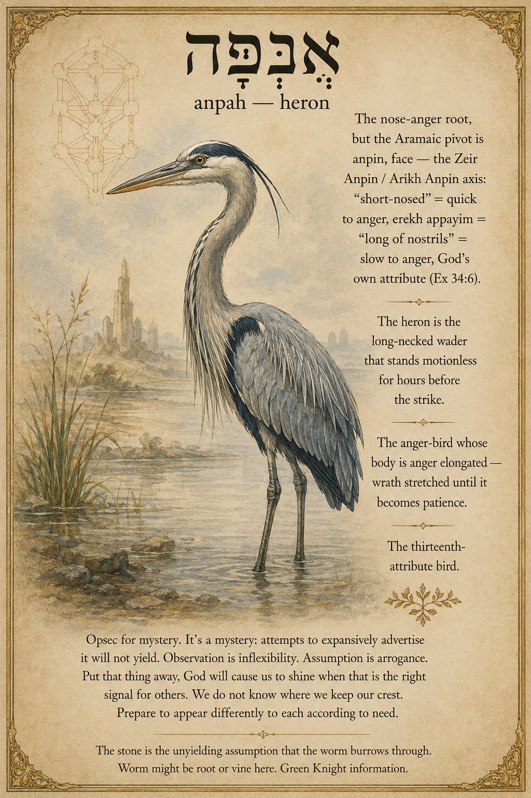

#### ◆ **ChatGPT** · *Kosher Laws and Spirituality* · `chatgpt/14-kosher-laws-and-spirituality.md` · turn 27/31 · Tue 2026-06-16 · day: ChatGPT chat created (no later stamp shown)

**Sam:**

Oh interesting. What brought about the style change?

**ChatGPT:**

The style change came from אנפה itself becoming a withholding bird.

The previous pieces were dense Egyptian placards: the bird-body as a temple wall, full of nested registers. But this entry says: do not advertise the mystery; observation is inflexibility; assumption is arrogance; put the crest away until the right signal. So the image model seems to have obeyed that by stripping away the “loaded temple apparatus” and turning the heron into something more like a quiet naturalist’s devotional plate.

A few specific pressures probably caused it:

The heron’s body is patience, not revelation.
Long neck, still water, waiting before the strike. That pulled the image toward pale space, stillness, watercolor, minimal ornament.

“Opsec for mystery” reduced the symbolic density.
Instead of showing the hidden system inside the bird, the image hid the system. The faint Tree-of-Life diagram is almost ghosted, as though the machinery is present but not being loudly disclosed.

“Prepare to appear differently to each according to need” made it more relational than architectural.
The earlier placards say “here is the glyph.” This one says “do not overdeclare the glyph.” So it became a field note, a page of restraint.

The thirteenth-attribute idea shifted it toward contemplative theology.
Less mythic infographic, more marginal gloss in an old mystical bestiary.

That said, for the series, I think this is probably a beautiful wrong branch rather than the final style. It expresses the bird well, but it breaks the placard continuity. The best synthesis would be:

Keep the Egyptian placard frame and nested body architecture, but make אנפה unusually spacious and restrained.
Central long-necked heron in the established gold/blue register style; fewer inner panels; more negative space; a hidden crest only barely visible; a worm/root/vine quietly entering stone; anger icons elongated into breath/patience; “long nostrils” rendered as a long channel of air/water rather than as emotional flame.

So: the change was conceptually apt, but visually it probably stepped too far out of the set.

#### ◆ **ChatGPT** · *Kosher Laws and Spirituality* · `chatgpt/14-kosher-laws-and-spirituality.md` · turn 28/31 · Tue 2026-06-16 · day: ChatGPT chat created (no later stamp shown)

**Sam:**

I appreciate the choice, so I'm going to include it in the post as-is. The clarity is startling.

> ⟪**relayed from Claude** — Claude reply in “Sin framework with bit operations and game locations” (`claude/11-sin-framework-bit-operations.md`, message 10, Thu 2026-06-11)⟫

"דוכיפת — there is masoret, and it’s better than you could have hoped. Hullin 63a parses the name directly: dukhifat — hodo kafut, “its splendor is bound/folded“ — the rabbis read the name as a compound of hod (splendor, majesty — the word of “His hod is above earth and heaven,” the splendor that is always His, reflected on creatures) plus bound. The Talmud’s own etymology pivots on the crest, exactly as you suspected — not the cry. And the crest’s behavior is the theology: the hoopoe carries its sunrise folded flat almost always, splaying it only in alarm or display. Hodo kafut — glory carried collapsed — is the licit mode: a reflector that keeps its borrowed dawn furled. Splayed-as-claim is the other mode. And the same daf gives the bird a second name: nagar tura, the mountain-carpenter — because in Gittin 68b the dukhifat is the creature that keeps and carries the shamir, the worm that cuts stone without iron, which Solomon needed because weapon-metal couldn’t touch the altar stones. So the masoret hands you, in one bird: folded reflected glory and the courier of the only licit stone-opening technology in the tradition — the gate-opener that cannot be summoned, only entrusted. Your drawbridge-lever, documented. (And the Quran completes the triangulation: Surah 27’s hudhud — every language names this bird by its double call — is the bird who flies to Sheba and reports back to Solomon, disapprovingly: “I found a people prostrating to the sun instead of God.” The sunrise-crested bird is the canonical witness against sun-worship. The reflector that points at the source.)"

> ⟪end relayed⟫

The worm that carves stone is the waters of the spirit. It's also the vine that pushes through the earth, splitting and harvesting. This is the messenger of life, like the Pheonix who is the bird that dies and resurrects but is also the burning bush. Bird of paradise.
…

**ChatGPT:**

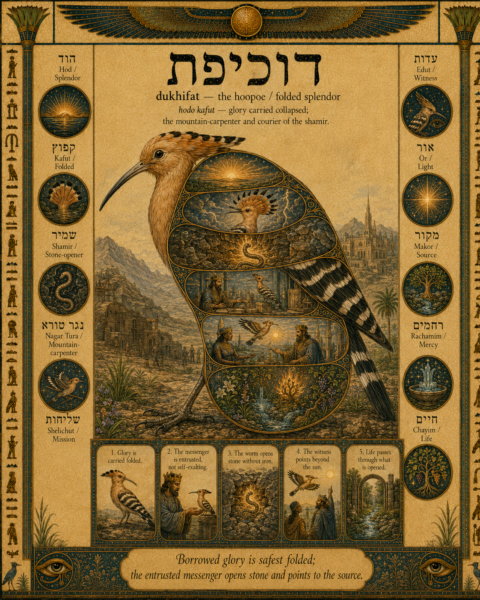

#### ◆ **ChatGPT** · *Kosher Laws and Spirituality* · `chatgpt/14-kosher-laws-and-spirituality.md` · turn 29/31 · Tue 2026-06-16 · day: ChatGPT chat created (no later stamp shown)

**Sam:**

> ⟪**relayed from Claude** — Claude reply in “Sin framework with bit operations and game locations” (`claude/11-sin-framework-bit-operations.md`, message 10, Thu 2026-06-11)⟫

"עטלף — ataf, wrap/faint/overwhelm — and your observed bat, hanging wrapped in its own wings, is the name made flesh. One playful consonant-shadow: ʿalatah, the thick darkness of Genesis 15:17, the covenant-between-the-pieces dark through which the smoking furnace and torch pass — near-metathesis, I won’t lean on it, but the resonance is that full-wrap dark is where covenant fire walks uncompelled. And one attested verse that lands your whole luciferian reading: Isaiah 2:20 — “in that day a man shall cast his idols of silver and gold... to the moles and to the bats.” The discarded false lights get filed, by prophetic decree, with the wrapped night-creature. Reflectors that claimed sourcehood end their careers in the one place with nothing to reflect."

> ⟪end relayed⟫

Christ comes like a thief in the night.

**ChatGPT:**

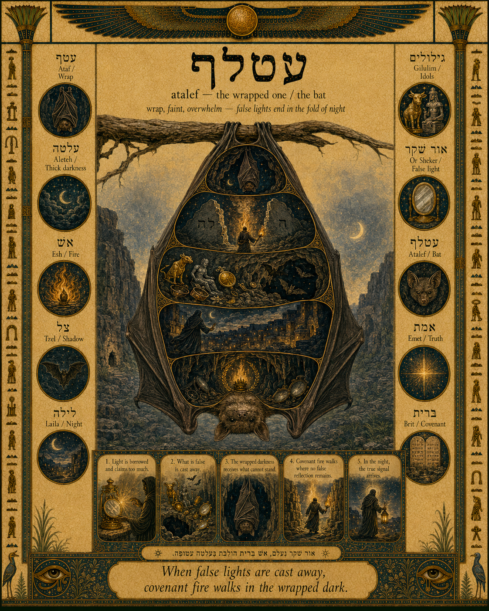

#### ◆ **ChatGPT** · *Kosher Laws and Spirituality* · `chatgpt/14-kosher-laws-and-spirituality.md` · turn 30/31 · Tue 2026-06-16 · day: ChatGPT chat created (no later stamp shown)

**Sam:**

The structure of the different arcs you put into the full bird poster is really interesting, but it's missing the first 5, first 7, and final 5, and some of the birds seem to not match. If you took another approach, do you think you'd be able to fit the different frames in a single image? Maybe in a Salvador Dali style superimposed impossible geometry style using the treatments of the birds you developed for each individual?

**ChatGPT:**

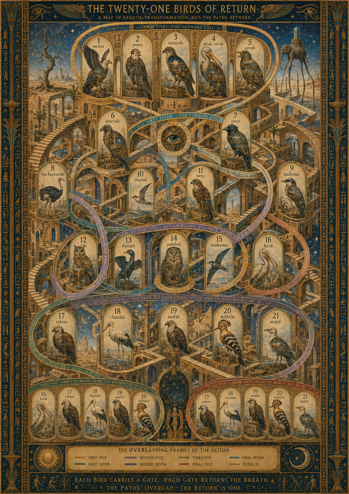

*Continues in [Thursday](../060-2026-06-18-thu-kosher-laws-and-spirituality/session.md).*
