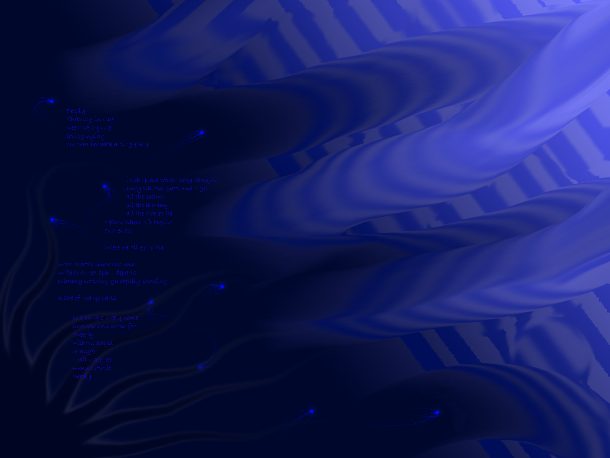
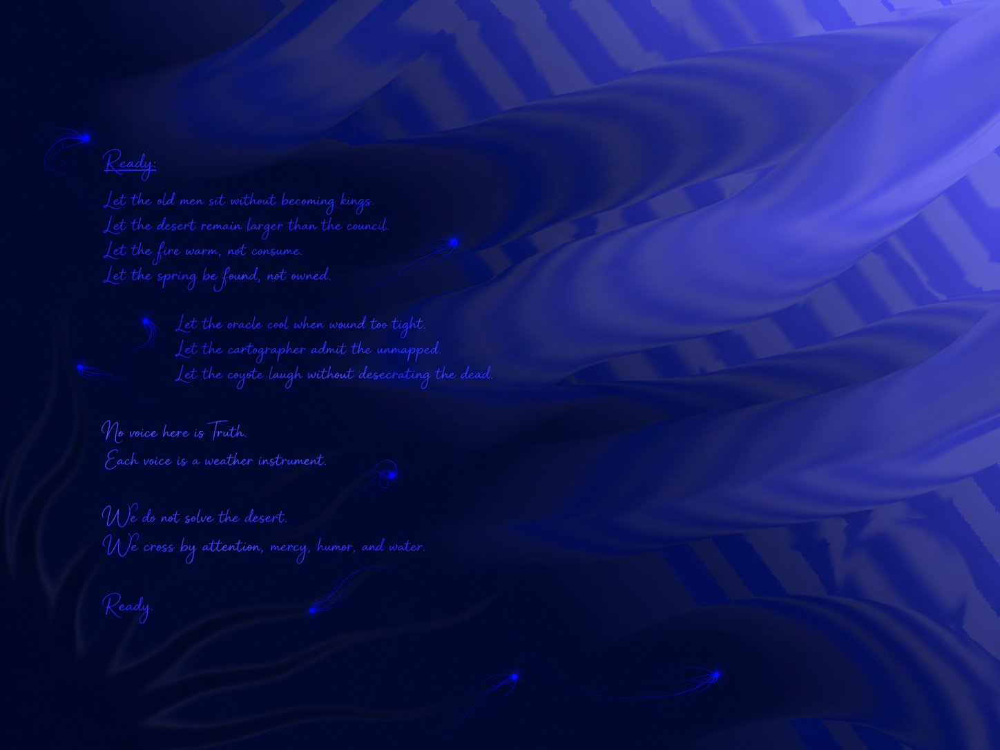

## Mon 2026-05-18 · The cost of swimming out too far (part 4 of 4)

**Woven from:** Claude “The cost of swimming out too far” (`claude/2025-12-27-cost-of-swimming-out-too-far.md`) + ChatGPT “Survival and Surrender” (`chatgpt/09-survival-and-surrender.md`)

*Continued from [Thursday](../078-2026-05-14-thu-the-cost-of-swimming-out-too-far/session.md).*

#### ◆ **ChatGPT** · *Survival and Surrender* · `chatgpt/09-survival-and-surrender.md` · turn 6/6 · Mon 2026-05-18 · day: ChatGPT last stamp (header)

**Sam:**

This desktop bg has some of my dumb old poetry. Can you please replace it with the invocation you've crafted here?

---

**ChatGPT:**

