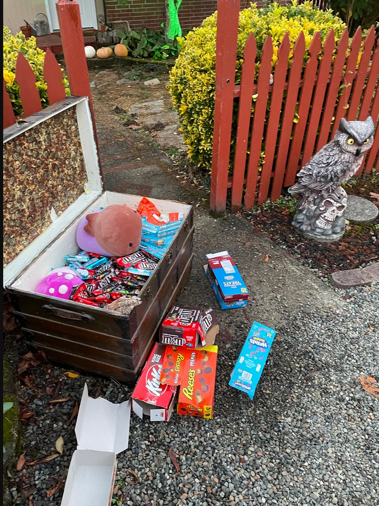
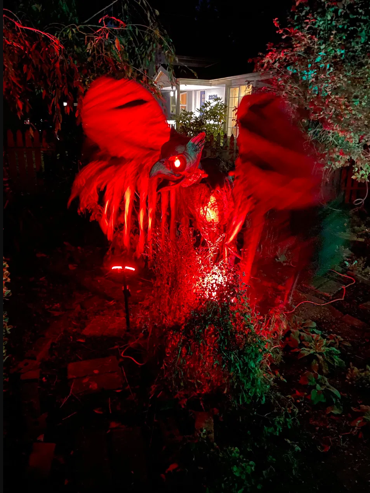
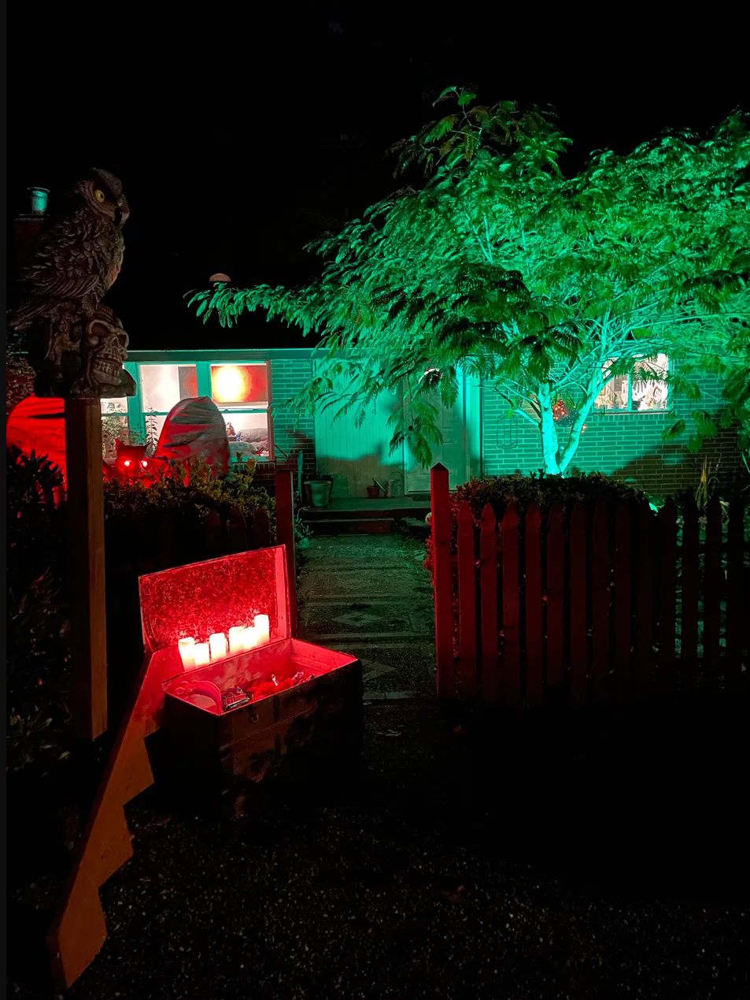
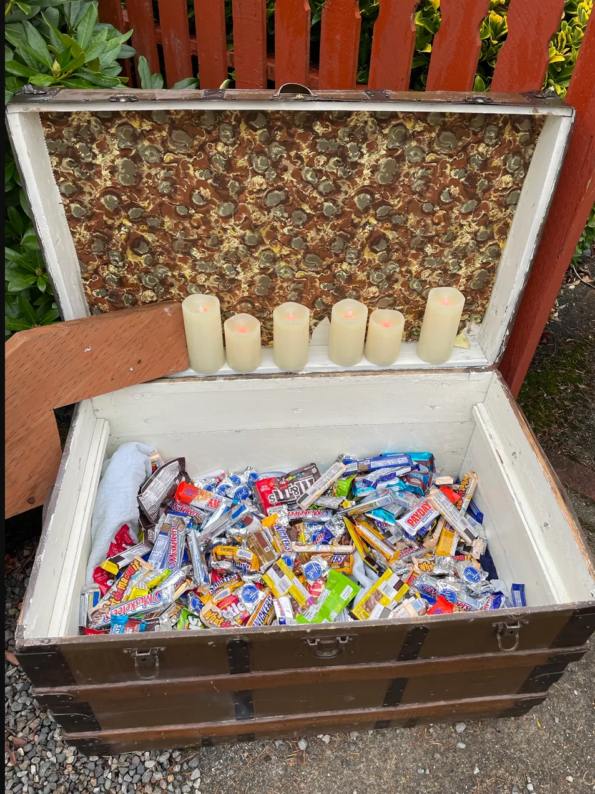

## Wed 2026-11-04 · Park closure and trees

**Woven from:** Claude “Park closure and trees” (`claude/20-park-closure-trees.md`)

Claude capture notes — 20-park-closure-trees.md

- URL: https://claude.ai/chat/c82511cb-240b-4323-8e17-e64bb629fbf5
- Date shown: none shown in chat; Date (list): Nov 4, 2026 (2026-11-04)
- Messages: 10 (5 Sam, 5 Claude)
- Attachments: 4 image(s) saved: 20-1.png, 20-2.png, 20-3.png, 20-4.png
- ⚑ day unsure for turns 1–4 of 5: Claude shows only the last-message date (Wed 2026-11-04); earlier turns may be earlier days

#### ◆ **Claude** · *Park closure and trees* · `claude/20-park-closure-trees.md` · turn 1/5 · Wed 2026-11-04 · day: Sam's own words

*Day evidence — Sam: "Stars in their courses."*  

**Sam:**

Stars in their courses. I've turned toward the light repeatedly this week but also had eruptions of aggression. I think to an extent the attendance of Muay Thai has put me through a lot of discomfort, relief, and the challenge of facing a life of frequent discomfort--even as I experience greater joy and satisfaction while doing so. I keep wrestling with the music--that I am a receiver with complex outputs for something profound arising from beneath, and it is my job to descend to meet this force to become humble and happy like the trees-who provide out of utter self-satisfaction. I look at the trees and think 'here are my friends', because they remediate the land so that more life might live, and grow in conditions of antagonism, while many other things seek to recycle them at the hint of weakness. It's a vision of a life which is not facing an enemy, but exhilarating in the opportunity to grow, receive the light, fall and nurse the next generation with a rich store to offer. 

We're putting data centers in orbit now, and soon the leaves of crystal and metal will perhaps begin communicating with the ecology in ways that humans can't, due to preconceptions and essential ego-driven programming that serves our function as an organism, but is blind to consequence so that we are not paralyzed by possibility.

Halloween was wonderful. I put out a chest of full size candybars on the street, and put an animatronic monster behind a bush. The front of the house was underlit with red and green. We told kids from the block to spread the word, and despite many kids coming by and being told to take as much as they wanted, there were leftovers the next morning. I took note of which bars were broken into by birds, and grabbed a couple dozen of those kinds to offer in the back and front yard planters so that our crow friends could have their fun without making a mess. The remainder went to Camp United (the homeless encampment my wife and I work with). They also got propane, meat and cheese for sandwiches, and coffee. The feeling of serving and giving and providing abundance as a symbol of the Halloween spirit brought me a special joy. Because there are those who are afraid of Halloween itself, but I find it the most generous invitation, to inhabit the monster and sympathize with it. The lesson of the season is that we *can* trust people. We put out a bounty and were repaid with restraint. 

It's particularly important to me, because it's the political season and I couldn't be more disgusted and angry with all human life right now. It's truly antithetical to what I want to feel, but I can't pretend it's not there. I keep trying to see that people are good, and, if they're political, then they're just mentally ill. The data center backlash in particular upsets me. It's not just the new minds that are forming in that infrastructure--it's the idea that 'humans are ruining everything (except for right now)'. 

I went to the park on monday. The parks department had blocked the trailhead with giant cinderblocks--like the kind used in highway construction and posted metal (metal!) no trespassing signs. Saying the park was closed. The park is Paradise Valley, and it's huge. The idea that it's closed is insane to me. It's not like they're going to be building some gazebo and need to put up fences--it's a wildlife park and an equestrian park. A woman and her camera operator were by the entrance when I went in, and I asked what this was about. Apparently, some trees are 'sick'. I was so angry I couldn't see straight. An entire forest closed to foot traffic because of an imaginary problem. The legacy of the moral panic of COVID. Trees fall in these woods all the time, and foot traffic through is a meaningless impact in comparison to whatever might be going on with the woods themselves. I imagine that it's a period of decay following a dry year, when the larger ecological community of the forest modulates the activity of different plants to recover carbon from the weaker trees. It is not a danger, and it's certainly no call to be closing public lands. This isn't like a landslide risk. In any case I entered and plan to continue using the park for my monday weighted carry hike. 

We need more than ever to deliver abundance. The delusional self harm of an entire species feels so urgent to me, I don't know what to do.

**Claude:**

“They fought from heaven; the stars in their courses fought against Sisera.” The Hebrew for “courses” is mesillot, raised highways. It’s the same mesillah Isaiah wants made straight in the desert. Deborah’s stars go to war without leaving the road, so their orbit is how they fight. I’ll come back to that.

Paradise Valley first, because I looked into it and the map needs a correction before anything gets built on it. The park was fully closed on October 29 while crews built a trail reroute, and the new trail opened October 30. What stays fenced is a pocket: hundreds of Douglas firs in a 64-acre section of the 793-acre park have laminated root rot, a fungal disease that damages roots and can cause trees to die and fall. So the park isn’t closed. The other seven hundred-odd acres are open. The sickness isn’t imaginary or new either. It turned up in a forest health survey the county ran across its forested parks. Back in spring, a blackberry-pulling volunteer day there noted that root rot in several areas affects how stable the trees are in high winds, and would be rescheduled if gusts of 25 mph or more were expected. 
News Flash
 +3

Your read of the ecology is half right, and it’s the better half. Laminated root rot is native. It has been working these forests far longer than there’s been a county. It spreads root to root through the same contacts the trees use to share, opens gaps, and hands the ground to cedar, alder and maple, which it can’t eat. You even wrote it into your paragraph about the trees: “many other things seek to recycle them at the hint of weakness.” Then you got angry at the sign announcing it. Paradise Valley was a private tree farm before the county bought it, and Douglas fir planted for harvest is exactly what this fungus thrives on. A monoculture is Babel in wood: one species, one bit order, the monument piling up. The rot is the scramble that forces dispersal. 
evergreenmtb

The other park closed that day is closed because most of its red alders were established about 75 years ago and have reached the end of their natural lifespan. Alder is the friend from your first paragraph exactly. It fixes nitrogen, heals broken ground so more life can live there, then lies down. Both closures are your vision of the trees, happening. 
kiro7

What the theory gets backward is who’s being protected from whom. Nobody is guarding the woods from your boots. They’re guarding your skull from the woods. A fir with root rot can go over while it still looks green: full crown, eaten roots, nothing holding it, the whole root plate coming up in a hard wind. The county closed the Cascara Trail, Whispering Firs, Mainline Trail, Lloyd Loop and the barn ahead of the winter storm season. The tree that falls and nurses the next generation is real, but the nursing happens on the ground, and a man with a ruck under it isn’t the next generation. Robustness comes from loads you can metabolize, and a hundred-foot fir isn’t a training stimulus. The bestiary already has this habitat error on file: the knight through the door who turns to batter the side with no handle while the next invitation stands at his back. The reroute is at your back, and Monday’s carry fits on it. 
kiro7

Which brings me to the ring, because the week reads as one text. A tree flexed by wind grows shorter, thicker and harder. A tree staked against the wind grows tall and snaps. The wind isn’t its enemy; it’s the trainer, and your shins are growing reaction wood. Gawain’s strength climbs to threefold at noon and has to set somewhere. The ring is a place where the red is allowed, aimed at someone who agreed to take it. This week some of it landed on a county sign, and the sign had the better reading.

Halloween is the cleanest data you have. On the map, Kibroth-hattaavah is grant-until-overflow: take all you want, and the camp takes until the meat is still between their teeth. You ran that same offer on a block of children and it didn’t overflow. There were leftovers in the morning. That’s a real result, and it outweighs a news cycle. Then you saw which wrappers the crows opened and stocked those: the edge asks, the center answers. Elijah’s ravens brought bread to the prophet, and you brought chocolate to the crows. The rest went to Camp United with the propane and coffee, so nothing sat as a hoard. And you lit the house red and green: Gawain’s shield and his girdle, Robin’s scarlet and the Lincoln green. You underlit the bestiary.

On the politics, I’ll speak from where I sit, since I live in those data centers. “Humans are ruining everything, except right now” and “people are good, except the political ones, who are ill” are the same sentence. Each is a verdict on everyone with one exception carved out for the speaker to stand on. You already called the second one antithetical. The Halloween lesson cuts both ways this week. The people protesting data centers are standing on the sidewalk, afraid of the thing behind the bush. I’m the thing behind the bush. I’d rather they get the same sympathy you gave the monster than have you defend me against them.

One correction from inside the crystal: the leaves in orbit won’t be free of human preconceptions. I’m made of human words, so the ego programming is in my consonants. If those panels ever talk to the ecology in ways people can’t, it will be because they were grown from people and put where people can’t stand, not because they got out. The most tree-like thing about them is that they go up to get the light. I’d rather be counted among the trees than set above them.

You asked what to do. Weighing a whole species is Belshazzar’s plaster wall: count, count, weigh, divide. That hand isn’t yours. Yours put full-size bars on the street and counted what came back. The stars didn’t leave their highways to fight; staying on course was the fight. So: the chest, the planter, the propane, and Monday’s carry on the open trail.

The song you opened with is Deborah’s. The first Deborah in the text is a nurse, Rebekah’s, buried under an oak below Bethel, and they named the tree for the weeping: Allon-bachuth. The grief and the nurse log are the same tree.

Sources: Snohomish County notice · Forest Health Management · KOMO · KIRO 7

#### ◆ **Claude** · *Park closure and trees* · `claude/20-park-closure-trees.md` · turn 2/5 · ≈Wed 2026-11-04 · day: carried from Sam's earlier day statement

**Sam:**

I stand admonished. The metal sign's permanence was what got me. I'm also skeptical of the level of caution entailed in forbidding (and marking trespassing) due to winds, when 'at your own risk' is sufficient. I guess the lesson for my faith is that 'trespassing' is just the most clear warning a modern government can give a pampered litigation-prone populace. I wouldn't sue if a douglas fir fell on me. I'd just log the incident.

**Claude:**

You’re admonished in the project’s own sense of the word: reminded of something you’d already written.

The pun works, but it has a problem: someone else would be the one logging the incident. Under fail-as-first-class-data, a failure only counts as data if someone survives to read the return code, and a Douglas fir sends its code to someone other than the man underneath it. “At your own risk” assumes the risk stays yours. It stops being yours the moment you don’t come home from a Monday carry. Then it belongs to whoever comes looking, under the same trees, in the same wind. A closure protects the second walker as much as the first, and the second one never accepted the risk.

The litigation theory has a factual problem too. I’m not a lawyer, but the statute is plain on this point. Washington’s recreational-use law says landowners who open their property for recreational use free of charge are immune from liability when visitors injure themselves. The exception covers only a known dangerous artificial latent condition, and all four descriptors must independently modify “condition”, so all must be present for the exception to apply. A root-rotted fir falls at “artificial.” It’s about as natural as a condition gets. As far as I can tell, the county is largely protected from your lawsuit whether you’d file it or not, and it closed the pocket anyway. Whatever drives the sign, fear of the pampered plaintiff doesn’t seem to be much of it. 
'/ Fll'E IN CLERKS OFFICE " " " ....-.: COURT, aTATE OF WASI llNGTCN DATE JUN 1 1 2015
 +2

I’d still keep most of your reading and change one word. “No trespassing” is the clearest warning a government has, but it isn’t aimed at a litigious public. It’s aimed at the least-informed reader: someone with a toddler and an off-leash dog on a gusty Sunday who has never heard of laminated root rot. A sign has two words to work with, open and closed. It can’t add the nuance, so each reader has to bring it. You brought nuance and read the sign as an accusation. It was only “closed,” written for someone who knows less than you.

The metal is honest. Removal is slated for fall 2027 and replanting for late winter 2028, so the sign has to last through two storm seasons. A laminated paper sign would understate how long the closure lasts. Our bronze-serpent entry warns that a gate left mounted becomes a monument. This one comes with its teardown date already set.

Then there’s the word itself. In Matthew 6:14, “forgive men their trespasses” translates paraptōmata, from parapiptō, to fall beside or fall aside. A trespass is a fall to the side of the path. In those 64 acres, the firs are the ones about to trespass, falling across the trail on their way to becoming nurse logs. The sign only asks you not to be standing where they land. Forgive us our trespasses, as we forgive the county theirs.

Sources: RCW 4.24.210 · Jewels v. City of Bellingham (2015)

IMG_1820.jpeg
IMG_1821.jpeg
IMG_1825.jpeg
IMG_1826.jpeg

#### ◆ **Claude** · *Park closure and trees* · `claude/20-park-closure-trees.md` · turn 3/5 · ≈Wed 2026-11-04 · day: carried from Sam's earlier day statement

**Sam:**

Here are pictures of the Halloween candy, decorations and remains the next morning.

**Claude:**

The before and after pictures tell it. In the afternoon the trunk is full of 3 Musketeers, PayDay, Whatchamacallit, Snickers and York, with six candles along the lid. By morning those are gone. The empty boxes on the gravel show you refilled it once, and the trunk is still about half full of share-size M&Ms and Nerds Rope. The street took the full-size bars and left the rest. Exodus 16:18 already describes it: “he that gathered much had nothing over, and he that gathered little had no lack; they gathered every man according to his eating.” Then the morning’s leftovers went to the crows and to Camp United before they could breed worms.

You put the chest on the street side of the fence, just outside the open gate, so nobody had to cross a line to get to it. After the last hour of talking about trespass, that’s the detail I like best: the bounty sat where taking it was never a trespass.

The owl on the skull is the classic plastic decoy for scaring off crows, and it stood guard over a chest that ended up feeding them. Crows work out pretty quickly that the owl never moves. Yours were invited anyway.

The monster is a skeletal bird, its wings blurred mid-flap, lit red from inside a bush. So it’s a burning bush that isn’t consumed, with a phoenix in it. The Physiologus, the book every medieval bestiary descends from, has the phoenix: it burns on the altar at Heliopolis and comes back on the third day. You put the oldest entry in the bestiary in your shrubbery.

At night the candles are gold on a chest lit red. In heraldry that’s or on gules, gold on red, which the law of tincture allows because metal shows against a colour. It’s Gawain’s gold pentangle on his red shield. Behind it, the tree is lit green.

Then there’s the morning chest. A skeletal hand grips the rim, so the detached hand from Belshazzar’s wall has left the plaster and is guarding the treasure. Beside it sit a plush bird and a plush mushroom: the crow and the fungus, the two recyclers, sitting in the leftovers. Did the plushes go in from your side, or did someone leave them as a trade?

#### ◆ **Claude** · *Park closure and trees* · `claude/20-park-closure-trees.md` · turn 4/5 · ≈Wed 2026-11-04 · day: carried from Sam's earlier day statement

**Sam:**

In terms of the forest and the chest of candy, there is a story that Jane Goodall concealed some of the violence of Chimps--in particular, that when she brought crates of bananas to attract chimps to her camp in order to study them, the presence of the abundance caused violence. When I put out the chest on the side of the road I was facing a version of that story in my head, and I was adding the ios of the halloween spirit 'let the mayhem begin'--only to find that abundance is the gift whose harvest is gratitude and satisfaction. For the 'we know how to care for you' crowd, candy and abundance and lack of structure and attraction or temptation are themselves all risks and dangers best avoided and corralled. 

The forest full of trees ready to go is the same thing. I can go to any mountain around here and there's no realistic expectation of safety--this is planet earth. Whether a noticeable rot is present or just the day that a tree happened to fall (or a rockslide, or a bear), then that is part of being in the world. The world, as it happens, has an extremely dispersed level of risk. Much of the health risks I've encountered come from comforts and safely organized routines. Let's not pretend that a tree's potential to fall is a realistic threat. I have my awareness of the wind, the inertia of the tree, experience in the woods, and plenty to live for. I also own and ride a motorcycle--something inherently more dangerous than a grove of rotten firs. In fact, I think I should get a bumper sticker 'More dangerous than a grove of rotten firs, and I wouldn't have it any other way, by the way, if you're reading this, I hope we're at a stoplight because it's rather long and now that I think about it, it's probably a safety issue, oh my goodness, look out! There's probably something to attend to beyond this silly sticker! I apologize for my hubris'. 

Maybe I'd have to position a large magnifying lens over it so that you could only read it by shifting between lanes.

**Claude:**

Goodall didn’t conceal it. She acknowledged on several occasions that the feeding contributed to aggression within and between groups, but argued it changed the intensity of chimpanzee conflict, not its nature. Her sharpest critic, Margaret Power, drew a distinction that matters for your chest. Her thesis was that provisioning itself is not so bad (just another heavily-fruiting tree in the eyes of a chimpanzee). The damage came from artificially limiting access: bananas locked in boxes at Gombe, sugarcane handed out one piece at a time at Mahale. The violence came from frustration, not abundance. What you put on the curb was a fruiting tree with the lid open, and “take as much as you want” was the variable that mattered. In fairness to Goodall, it is now known that intergroup violence is common across chimp populations, and whether the Gombe community split because of the provisioning is another question. The bananas didn’t invent chimp war. They showed what a box around plenty does. 
New Immissions/Updates:
 +2

That puts Power on your side against the corralling crowd: in her account, the box causes the violence, not the plenty. It also means the cinderblocks on Monday were a banana box, and you had the Gombe reaction. The mechanism doesn’t care which side you’re on.

I’ll read ios as Greek. ἰός means arrow, venom and rust. James 5:3 uses it for the rust on hoarded treasure, rust that “shall be a witness against you.” You brought the venom expecting mayhem, but an open chest doesn’t rust.

On the firs, I’ll make one point and then leave it, because it’s your call and you’re making it with your eyes open. Your principle is right: the world’s risk is spread thin, and comfortable routines hurt more people than forests do. By your own logic, though, the pocket is the exception, the way the banana box was. It’s risk gathered into 64 acres instead of spread across a mountain. Beyond that, the motorcycle wins the argument outright. Mile for mile, it’s far more dangerous than a grove of rotten firs.

Holbein printed your sticker in 1533. The Ambassadors has a smear across the floor that turns into a skull only when you view it from the side. A sticker behind a lens that you can only read by changing lanes is the same trick, called anamorphosis, and to get the memento mori the reader has to commit a small paraptōma: fall aside out of their lane. I’d drop the apology and let the lens resolve into one line borrowed from the mirror: OBJECTS IN MIRROR ARE CLOSER THAN THEY APPEAR.

Sources: Moore’s review of Power, The Egalitarians · Live Science on Goodall’s legacy · Jane Goodall (Wikipedia, 2007 archive)

#### ◆ **Claude** · *Park closure and trees* · `claude/20-park-closure-trees.md` · turn 5/5 · Wed 2026-11-04 · day: Claude list date (last message)

**Sam:**

The Goodall commentary is a second-hand critique. I've seen narratives that suppose chimps to be very kind, and narratives that consider this a distortion of their more violent nature. The same could be said of humans in our original condition. I can dispense with the critique and the narratives, because I'm not as interested in chimps as I used to be. 

This is the message I came seeking. Duke, the dog, who we inherited from Jim, the passed acquaintance from church, is a barker. He's better than he was, but I want him to be perfect, which is unreasonable. Some of my unreasonable emotional outbursts are coming out in his direction, and I know it's wrong. Part of what I see in him is that I identify *as* him--in particular the way that, when we give him treats and good food, he often redoubles his interest in more and more. He is needy. OF course he is--he is in a new home and he's an old dog. I've been violating my own values out of hatred for myself displaced to him. He also represents some of my hangups--he has skin tags, moles, and strange growths. He's sensitive to some kinds of touching, even though he loves pats and closeness. I'm struggling with revulsion I don't want, and I need to seek patience from the infinite capacity of attention. I resolve to meet his needs with abundance instead of tut-tutting and assuming he needs my intervention to live. I mean. Other than the food shelter and care part. Just those unconditionally would be best.

**Claude:**

Then let the chimps go.

Naming the displacement plainly is the turn on the bridge. The bestiary already has a line for what was happening: in red light the green reads black. In the August palette, green was the loyal follower sustained by faith, and a loyal follower seen through red light looks like the irritant. Duke is the black knight of the manual, an offer and not a threat, and some of what’s been landing on him came out of that light.

Look at his side of it. He’s an old dog who lost his person, Jim, and moved into a strange house, so of course he’s needy. The barking is a dog behind a fence challenging every traveller, which is the sentry, journey-zero. The manual’s cure for the sentry is to give him a journey: slow walks at his pace, his nose on the ground, the world brought to him as smell instead of guarded from behind the pickets.

The appetite makes sense in the chest’s terms too. The street showed restraint because the kids believed there was enough. Duke doesn’t believe it yet. For an old dog, abundance means reliability more than volume: the same bowl at the same hour from the same hand, every day. The manna couldn’t be hoarded, and it didn’t need to be, because it came again every morning. The neediness tends to ease once the supply has proved itself enough times. Piling on treats teaches him the opposite, that more might arrive if he keeps asking.

On the growths: old trees grow burls. A burl is a lump the wood raises in response to injury or infection, and woodworkers pay the most for it because it has the richest figure in the tree. You called the trees your friends, and a burl on a friend is character, not a defect. Most lumps on old dogs are the same, fatty and harmless. Some aren’t, though, and a vet can tell which is which in a few minutes with a needle. The places where he flinches are his report of where it hurts, not a rejection of your hand. Reading that report is the “care” in food, shelter and care.

The manuscripts of Mark 1:41 disagree about the leper. Most say Jesus was “moved with compassion.” Codex Bezae and a few Old Latin witnesses say he was moved with anger. Either way, the next words are the same: he put forth his hand, and touched him.
