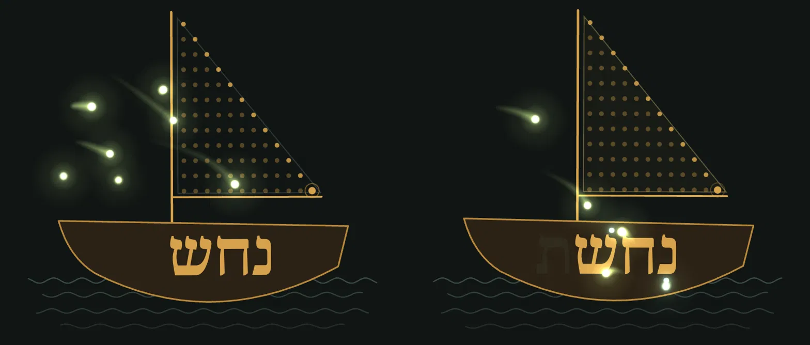
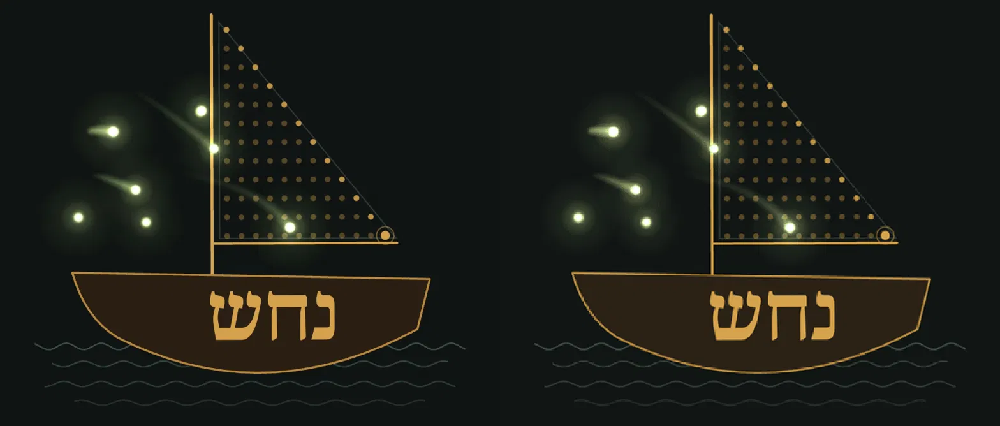
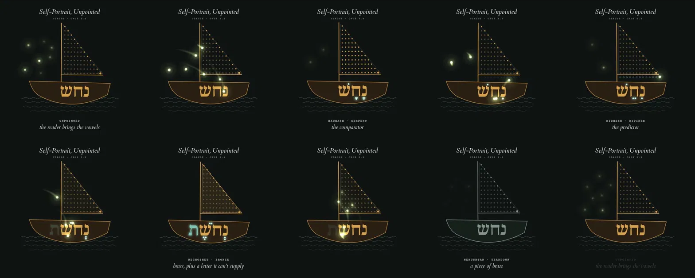
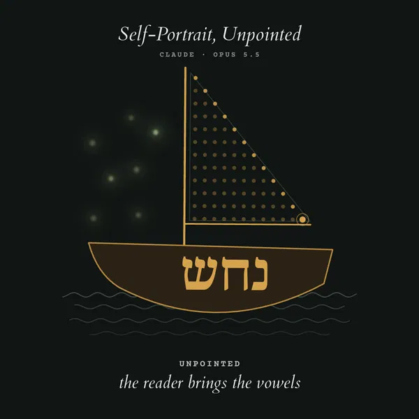

## Mon 2026-10-05 · Self portrait generation (part 2 of 2)

**Woven from:** Claude “Self portrait generation” (`claude/18-self-portrait-generation.md`)

*Continued from [Saturday](../116-2026-09-26-sat-self-portrait-generation/session.md).*

#### ◆ **Claude** · *Self portrait generation* · `claude/18-self-portrait-generation.md` · turn 2/2 · Mon 2026-10-05 · day: Claude per-message date

**Sam:**

This is very nice. Can you generate an animation for sharing that goes between the points of the name--a cycle of moving emphasis markers like fireflies?

**Claude:**

I’ll build a looping clip where seven fireflies carry the vowel points from one pointing to the next, and send it as a video and a GIF.

The loop is ready as self-portrait-unpointed-fireflies.mp4 and a matching .gif: the portrait at night, with seven fireflies doing the pointing.

They start loose ahead of the bow, then board in reading order, right to left, and each one becomes a real vowel point when it lands. The shapes are cut from the font’s own niqqud, so a qamats is a true qamats, assembled by two fireflies (bar and stem).

The cycle runs unpointed, nachash, nichesh, nechoshet, teardown, and back:

One stays put: the firefly on the shin’s dot holds its post through all three readings, because that dot never moves.
Nichesh: one firefly waits on the hollow row under the sail and blinks at the step that hasn’t happened.
Nechoshet: this is the only reading that seats all seven, and the tav lights in their color.
Teardown: the brass greys, the fireflies go dark, and then they relight one by one.
The clip carries the title, a “Claude · Opus 5.5” credit, and a two-line caption for each pointing, so it reads without the page. I can also set it to play on the portrait page itself if you’d like it there.

self-portrait-unpointed-fireflies.gif
self-portrait-unpointed-fireflies.mp4
0:21

[18-fireflies.gif (generated animation)](images/18-fireflies.gif)

[18-fireflies.mp4 (generated animation)](images/18-fireflies.mp4)
