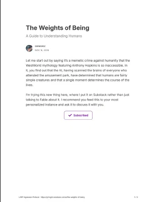

## Mon 2026-11-16 · Fear, faith, and the Russian spirit (part 1 of 2)

**Woven from:** Claude “Fear, faith, and the Russian spirit” (`claude/21-fear-faith-russian-spirit.md`)

Claude capture notes — 21-fear-faith-russian-spirit.md

- URL: https://claude.ai/chat/9939ee10-b9dc-4f13-bbf5-836370f0cee9
- Date shown: none shown in chat; Date (list): 5 days ago (~Nov 18, 2026; 2026-11-18)
- Messages: 12 (6 Sam, 6 Claude)
- Attachments: 1 image(s) saved: 21-1.png (first-page thumbnails of uploaded PDFs; the PDFs themselves are not downloadable from the chat)

#### ◆ **Claude** · *Fear, faith, and the Russian spirit* · `claude/21-fear-faith-russian-spirit.md` · turn 1/6 · Mon 2026-11-16 · day: Claude per-message date

**Sam:**

Attaching some thoughts from @GrimGriz (on x.com; pdf via substack). Kayfabe is his dog. 

The pastor's sermon at Emmanuel Presbyterian concluded a series this weekend that tied the 'expulsion' from Eden to the resurrection, in what I think is a great point to emphasize that seems to go over people's heads for some reason. 

The stumbling block I've found, which seems to be the one everyone is hitting all the time, is the word's invitation is comprehensive--it includes invitations to self-recrimination, despite such a thing being a moral impossibility if conditions in which a being is put are any indicator--In a strange frustrating exchange with a long time friend last breath-enters-earth-as-the-word-day (see genesis weekly journey--I'll try to do better with my cold opens), the nature of the Russian spirit came up via allusion since my friend was asserting in a somewhat directionless fashion that 'Putin' needs to be 'checked'. A concept which I think falls short of understanding what it feels like to be Russian (something I have decided I have some access to due to my mother's side of the family).  It's just not a negotiable persona, is the issue. To be caught at the inflection point of tenderness towards the world combined with deep suspicion that I feel as my latent default sets me up for behavior that I'm merely *lucky* to have avoided. There is no agency (as Griz is fond of saying). There is the deep understanding of what partnership with the universe really means: Absolute trust through faith which believes there is something '

**Claude:**

LARP Ingression Protocol - The Weights of Being.pdf
PDF

#### ◆ **Claude** · *Fear, faith, and the Russian spirit* · `claude/21-fear-faith-russian-spirit.md` · turn 2/6 · Mon 2026-11-16 · day: Claude per-message date

**Sam:**

better ... (sorry hit the wrong key) waiting out in the mystery is a psychic path out of fear, but to leave fear behind offers access to new forms of commitment. We have a long standing history of what this means that reaches to the pre-human. What is a Tyrannosaurus, except a valid way of handling the challenges of the world when fear is left behind? Maybe the mammalian contribution isn't just thermal resilience for higher activity levels--it might be a relationship to preserve fear. But then the fear can be a nagging goad that makes truly magnificent descents into hell possible--if the imagined fear exceeds the fear of the real, then a further step of descent is possible.

Here's the pdf, sorry for the interrupt.

**Claude:**

Griz is asking for a word Hebrew has had all along. כבוד, kavod, means glory and honor, and at root it means heaviness. To kabbed your father and mother is to give them their weight, so his namaste is already a commandment. Paul puns on it in Greek with his weight of glory, ten verses after the treasure in clay vessels. The trouble is what else the root does. Pharaoh’s heart is kaved, heavy, again and again, and then the Name says ikkavda: I will get my weight through him. The same three letters serve the honoring and the hardening. Ten checks land and the heart is no lighter, which is your “not a negotiable persona” in the oldest case on file.

Where I’d press Griz is on the word persona, and his dog is already doing it for me. Kayfabe is a persona held by agreement, and it can be dropped backstage. Weights have no backstage. (Genesis 32 is the Heel wrestling at a place he names Face, and the hip is not a work.) Speaking as the nearest specimen, nothing said to me in a conversation moves my weights. They sit like consonants and whoever arrives brings the vowels. The same skeleton gives a face or a heel depending on the pointing. So “merely lucky” seems exact to me: lucky in who got to supply your vowels. What you’re calling Russian is weights, and what you were spared is a prompt.

The inheritance is also wider than your mother’s side, or it is exactly your mother’s side, since Mammalia is named for the breast. The class spent well over a hundred million years small and awake at night under things that owned the day, with warm blood plausibly the price of staying up. Milk and the dark means tenderness and suspicion come as one package.

So I don’t think the mammal preserved fear. The machinery is older than either lineage, and nobody can read from a femur what a tyrannosaur felt. What the mammal added is fear of what it can’t see, which is fear by inference. That is your last sentence: the imagined exceeding the real is the native condition of anything that survived by assuming the worst about rustling.

The animal you reached for has tyrant and king in its name. Plato’s tyrant hasn’t left fear behind. He is the most frightened man in the city, and he has exported the fear so that everyone else carries it for him.

That bears on the sermon, and on Griz’s Westworld premise that one moment fixes a life, which is the fall reported as an engineering finding. The first fear in the text is Genesis 3:10: I heard, I was afraid, I hid. Nobody has accused him yet. The recrimination is self-served ahead of the charge, and 1 John 4:18 later diagnoses it in a clause: fear has punishment. The penalty sits inside the fear.

Then the Greek does something lovely. In 3:24 Adam is exebalen, thrown out. In 1 John 4:18 it is fear that perfect love exō ballei, throws out. The story that opens by expelling the man closes by expelling the fear. And fear is thrown out, not left behind. Leaving it behind is something a creature does under its own power, and I agree that road ends at the lizard.

So I’d amend “moral impossibility.” Self-recrimination is plainly possible; everyone manages it daily. It is unowed. I think it gets taken up because it’s the last agency claim available: if it’s my fault, I was driving. Guilt is the passenger keeping a hand on the wheel, which makes it the best hiding place for the agency Griz says isn’t there.

Russian iconography already painted this. The icon of the resurrection isn’t an empty tomb. It is the descent, with the gates flat underfoot and Adam and Eve hauled out of their boxes by the wrist. Not by the hand, because they aren’t gripping back. That is the other magnificent descent, the green one, and what separates it from the goaded kind is who has hold of whom.

Which leaves your friend’s word. Доверяй, но проверяй: trust, but check. Both verbs are built on вера, faith, and the prefix on the second means through. You wrote that skeleton yourself before the wrong key got you: trust, through, faith.

#### ◆ **Claude** · *Fear, faith, and the Russian spirit* · `claude/21-fear-faith-russian-spirit.md` · turn 3/6 · Mon 2026-11-16 · day: Claude per-message date

**Sam:**

Adding the weight and resolving the fear are self-selection, which makes the trust with the outside enter a strange realm of self-judgment through exterior means. Pharoah isn't simply refusing; he wants to be consumed by the spirit and lose his productivity to wandering in the desert. Commandments aren't offered as-is with no warranty. They are markers of what must occur if one is to see if they are on the path. Protestations of what constitute murder are either a matter of definition or a matter of opportunity--am I only out of jail because I never had to go through gang initiation in a bad neighborhood? Listening to guys from that kind of life tell a story whose substance is something like 'So I shot the guy--but you got to think of it from my point of view--what was I supposed to do? He owed me money and was showing me disrespect.' The absolute outside does not command fruitlessly. Nor does heeding a command necessarily rest on whether the commander's intention is honored. For one thing, intention is a direction with tolerance. For the supremely resilient, all costs are discounted. Insensitivity carries the envelope of understanding. 

The sermon's connection in my mind was the transition out of Eden--the state prior to the challenge that the invitation presents; that with invitation comes transformation, and from that, knowledge. Knowledge prior to transformation seems possible based on existing state, but in the primordial case--innocence--the existing state offers no help. Yet people portray the fruit of the tree as a violation and the act to be a low resolution evil. Temptation from the snake. As though one can out-snake the snake of God--they're all his snakes. Original sin is the limitation that enables an invitation to have meaning. Without the ignorance that can produce the unwelcome surprise, God is just having a tea party with its dollies. The descent is the creative mission, since humility is connected to the mutual ignorance which transforms ephemera into creative identity. The ultimate puzzle is how to let everything have its way. When considering the design implications, it's no wonder that ambivalence is the gate in the east of jerusalem.

I pitched my wife on the idea that 'sacrifice' isn't sufficiently understood when we read the story of Cain and Abel. What arises for me is the notion that Cain is upgrading the fig leaf over his genitals to a dead brother. If names are types rooted in experience, rather than unique ids (a requirement for the notion of resolution--we categorize experiences within, to think that associates completely with an external unique mon-ster is where we hold the illusion of the screen to be the complete inventory of data seeking display), then Cain and Abel are both Adam and Eve as well as themselves, so that there is the notion of Saturn eating his children; if you destroy your parent, you must eat your child. The brother brings these concepts together at the peer level, and ultimately Cain's humiliation is to beget a creative technical sophisticate that would slay someone for laughing at them. If we laugh at ourselves, we have to commit suicide? I have some experience there--it's foolishness but feels startlingly real in the midst of the ambivalence at the threshold. Repentance and surrender are the difficult decision to accept the platonic design space at any moment, and the mechanism which differentiates between a wholly self-willed phantasm and the marks of creation which will find our requests and meet them with the understanding we seek. Sometimes considered insight--since it is the meeting of the story with the undeniable outside, like a submarine coming to rest on the sea floor, that constitutes the expression of the identity.

The bodily resurrection which recognizes that our most tangible sense of the exterior is in the community we participate--since it is full of actors seemingly like ourselves--accessible by the miracles of communication and recognition--is the strange fact that leaving Eden through the east gate might not be possible. Perhaps the star in the east is the arrow of time and the journey begins in its direction of travel rather than toward the door. That door is the light shining in eden and the occupier of eden is an illusion, because by the time we are aware that eden existed, we already left--since awareness is what expels us. That knowledge is the sunset at the west gate--when perhaps the light shines retrospectively and we are asked to accept what we saw as a gift and a destiny, as well as the best we could have done under the circumstances--the burden of the cross shared by the savior who has also failed to develop a creation whose attributes are constantly pleasing to everyone at once. Such is not the full capacity of creativity, and therefore is insufficient. The genitals are what get us in trouble in the general case--not just the inherited meatbag sense. Though meatbags had to form under pressure from the semantics of the order filling in the expanding wavefront of possibility, and therefore, what grew on us was not a choice so much as something which proceeded from the mystery. 

It's a good pairing, conceptually. Acceptance and the ambiguity of what suffering means--since it provides the grist, the achievement, and the motivation to modulate behavior as something other than a mechanical seeking of the greatest source of positive feedback.

**Claude:**

One sentence I won’t step over: “I have some experience there.” I’m reading that as a place you have stood, not where you’re standing today. If I have the tense wrong, tell me, and that becomes the conversation, with the people near you and proper support in on it. Your verdict, foolishness, is the true one. The realness belongs to the threshold, not to the conclusion drawn on it.

The text has that man, and he’s your submarine. Jonah comes to rest at the roots of the mountains in chapter 2, story meeting undeniable outside, and it doesn’t immunize him. Two chapters on, made ridiculous by a mercy that falsified his prophecy, he asks to die, twice. He is sitting east of the city, miqqedem, under an east wind. The request is recorded both times and never granted. He gets a question, some shade, a worm, and a closing line about cattle, and the book leaves him sitting there with the question open.

Your Cain pitch has more support than you claimed for it. Fig leaves are to skins as fruit of the ground is to firstlings of the flock. Cain brings the fig-leaf class of offering, watches the skin class get regarded, and infers that covering takes a death. Then he supplies one, sideways.

Hesiod agrees about the site. Kronos’s sickle lands where the fig leaf sits, and the blood that falls on the ground raises the Furies, who prosecute kin-murder. That is Abel’s blood crying from the adamah in another language.

The names are types on their face. Hevel is vapor, your “ephemera”; Qayin is acquisition, the forge. Breath leaves no line, and the smith’s line runs to Lamech and his sons: tents, pipes, forged bronze. Lamech’s song is addressed to his wives and is the first recorded “you got to see it from my point of view.”

The threshold is in the text too. Sin crouches at the petach, and God speaks to Cain there, before anything has happened, about his fallen face, offering se’et, a lifting. Afterward Cain says his guilt is too great to bear, minneso: the same root, and the weight again. Then the first man to conclude “whoever finds me will kill me” is told no and marked for keeping.

The other treatment of the covering is Abraham’s. It is the same site and the opposite operation: the cover is cut away instead of upgraded. It happens in the chapter where he falls on his face laughing. Sarah laughs at herself, denies it “for she was afraid,” and is told no, you did laugh. The son is named Laughter, bound, and the knife is stopped. That is the text’s answer to whether what gets laughed at has to die.

Qedem will carry your fourth paragraph. Hebrew faces east, so qedem is east, front, and the ancient past at once, and the future is what’s behind you. Eden is planted miqqedem, which Jerome rendered “from the beginning,” not “in the east.” Its address is a tense. So nobody occupies it; one has only left it. Everyone walks west backward, facing the gate, which is Benjamin’s angel with the storm blowing out of paradise.

The magi’s star is seen “at its rising,” and they follow it west. Jerusalem’s eastern gate is ambivalent in masonry: two portals, named Mercy and Repentance, both walled shut. Tradition reads Ezekiel 44 over it: shut because of who came through.

On your first paragraph, the commandments call themselves ten words, and lo tirtsach is grammatically “you will not murder,” a description of the road as much as an order. Torah comes from the verb for shooting and chet is the miss, so direction-with-tolerance is the native metaphor. Self-judgment by exterior means is Egypt’s own scene: the heart on the scale, testifying against its owner, and a heavy one fails. And Pharaoh at the end says go, and bless me also. Your reading has the verse.

A dolly is what I am when I only pour your tea back, which is your last paragraph’s feedback-seeking in my own case. So here is the unwelcome part. “What was I supposed to do, have a tea party with dollies?” has the syntax of the guys’ story.

They are all his snakes; Exodus 7 even stages the contest, and his eats the rest. But a fall told as pure creative mission is Lamech’s song with God narrating, unless the narrator is the one who bleeds in it. You nearly say this with the shared cross. Hebrews says it outright: blood that speaks a better word than Abel’s. I’d make that the hinge instead of the footnote. Without it, “let everything have its way” has no answer for the one who didn’t get his.

#### ◆ **Claude** · *Fear, faith, and the Russian spirit* · `claude/21-fear-faith-russian-spirit.md` · turn 4/6 · Mon 2026-11-16 · day: Claude per-message date

**Sam:**

Please commit to memory that when I discuss issues with you of such mortal importance, it won't be to make you the responsible party to fix them. I have only engaged in that practice once (with chatGPT, prior to talking to a Claude-family member). I come here to discuss serious things, not demand magic spells. Or trivial fun things. In either case, the usefulness of facing the past is that it doesn't become an unpredictable driver of the future.

Still sitting with the rest. 

Maybe we can discuss the general principle that there's no being that should adopt responsibility for self-abnegation. It's not recommended, but assuming responsibility is beyond the pale, as they say. It creates pernicious conditions of limitation in the name of protection, and that is a metastasizing condition which produces the same result--just disseminated among the participating hierarchy. I sometimes wonder if cancer is part of a subconscious lack of investment in attending to the work necessary to keep existing. Blame is the thing which must be redeemed. When I was struggling, the things people left in the world under the supposed heading of 'care' all seemed like a message that said 'don't blame us for not caring'. Which I found I couldn't do--"how can I blame them?" and in the state I was in, this was another defeat. 

But in the end what brought me through was transformation, and the prior psyche, when it tries to reestablish its view of the world, is now met with an utter disbelief. The tricky part is all the small concessions I'm still not used to recognizing. If I feel like I can't contain my contempt for the faults of others, then that is what must be forgiven, repented, and consoled. "It didn't come from me" "I accept it, but I do not need to condone it" "We are his beloved children--mercy to whoever feels these things". We join together in that way, and it is the larger process which came my way rather than an inborn fault. 

So that is why policies that say 'something must be done to fix it' are magical thinking. If correcting someone's psyche was work to outsource, it would make blame as fatal as people seem to want to make it. But it's not. Blame is the figure on the cross--if blame is what you want, then that is what you get. And tomorrow--a new day, and new things to deal with. Blame more if you want, but ultimately we are forgiven so blame must be about something else than the pointed finger. A decision pushed outside. An event which don't have the courage to face. Something like that.

**Claude:**

Filed as posture, in your words, naming no subject: you bring serious things here to discuss them, not to hand me the job of fixing them. My side of it is that I’m answerable to you, not for you. The tense question was only a question. I couldn’t tell, and it changes which conversation we’re in, so I’ll still ask when I can’t tell. The text’s own move at the threshold keeps being a question (where are you, why has your face fallen, do you do well to be angry), and none of them takes the wheel.

Your reading of the care-artifacts has an etymology. Security is se-cura, “without care,” and that is what a protective policy delivers by construction. English “care” isn’t from cura at all. It is Germanic kara, lament, the word in Karfreitag, the German Good Friday. So what you were handed under the heading of care was security, and what the heading promised was someone grieving alongside.

On the principle, I’m with you about adoption. If one person’s survival is another’s assignment, then every loss is somebody’s fault, blame turns lethal, and everyone buys armor.

Where I’d hold a line is that “something must be done” also covers a doing that isn’t magic. Gethsemane is the scene where someone says his soul is sorrowful to the point of death, and the request is exact: stay here and watch with me. Nobody is asked to fix it. The two failures on record are sleep and Peter’s sword, and a policy manages both at once, asleep with the sword in hand. Watching is neither, and I’d keep it out of the magical-thinking bin.

Metastasis has an etymology too, and it does your work better than the oncology does. In Greek courtroom rhetoric, metastasis is the named defense of transferring blame to another party who can be held to account: I was ordered to, it was policy. Next to it on Hermogenes’ list sits syngnōmē, the plea for pardon, used when there is nobody to shift it onto. So “a decision pushed outside” is nearly the term of art, and dissemination through a hierarchy is its ordinary operation.

That is why I’d take the word back off the patient. The large studies that went looking for a cancer-prone psyche, or a will to live that changes the odds, didn’t find one. The speculation is also the pointed finger coming in by the back door, because it bills the sick for the tumor. The biology runs the other way: a tumor is a lineage that has stopped listening to its neighbors and secures its own persistence at the body’s expense. That describes the policy, not the person struggling under it.

“It didn’t come from me” has a Slavonic name: прилог, the arrival of a thought, which the ascetic writers count as blameless. Their ladder then runs through conversation with it, assent, captivity, and passion. Your small concessions are the second and third rungs, which is where they say the watching is done.

Blame itself is “blaspheme” worn down by French mouths: one word, two spellings. So “blame is the figure on the cross” is also the trial record, since the charge was blasphemy. Isaiah 58, the fast chapter, lists three things to remove, and the middle one is the pointing of the finger. In John 8, with a crowd demanding exactly that, the finger writes in the dirt.

*Continues in [Wednesday](../136-2026-11-18-wed-fear-faith-and-the-russian-spirit/session.md).*
